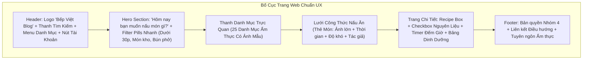

# TÀI LIỆU KHẢO SÁT HỆ THỐNG VÀ ĐẶC TẢ THIẾT KẾ GIAO DIỆN (GD.md)
## DỰ ÁN: CULINARY BLOG – BLOG ẨM THỰC VÀ NẤU ĂN
> **Mã tài liệu:** `GD-CULINARY-BLOG-V1.0`  
> **Môn học:** Phát triển Ứng dụng Web Nâng cao (PTUDWNC) – Nhóm 4  
> **Vai trò phụ trách:** Senior Frontend Engineer  
> **Tham khảo bố cục & UX:** [Budget Bytes](https://www.budgetbytes.com/) *(Bản địa hóa 100% cho ẩm thực & người dùng Việt Nam)*  
> **Ngôn ngữ hiển thị:** Tiếng Việt  
> **Trạng thái:** Báo cáo khảo sát & Đề xuất kiến trúc giao diện (Chờ duyệt)

---

## MỤC LỤC TỔNG QUAN

1. [Tổng quan Dự án và Công nghệ Thực tế](#1-tổng-quan-dự-án-và-công-nghệ-thực-tế)
2. [Cấu trúc Frontend Hiện tại và Các Thư viện Đã Cài](#2-cấu-trúc-frontend-hiện-tại-và-các-thư-viện-đã-cài)
3. [Hợp đồng Dữ liệu & Danh mục API Backend Khả dụng](#3-hợp-đồng-dữ-liệu--danh-mục-api-backend-khả-dụng)
4. [Phân tích Khả thi: Tính năng Có thể Triển khai vs. Tính năng Thiếu API](#4-phân-tích-khả-thi-tính-năng-có-thể-triển-khai-vs-tính-năng-thiếu-api)
5. [Đề xuất Thiết kế Giao diện Culinary Blog Tiếng Việt](#5-đề-xuất-thiết-kế-giao-diện-culinary-blog-tiếng-việt)
6. [Kế hoạch Triển khai Từng Bước & Tiêu chí Nghiệm thu (DoD)](#6-kế-hoạch-triển-khai-từng-bước--tiêu-chí-nghiệm-thu-dod)
7. [Quản trị Rủi ro Kỹ thuật & Các Câu hỏi Cần Thống nhất](#7-quản-trị-rủi-ro-kỹ-thuật--các-câu-hỏi-cần-thống-nhất)

---

## 1. TỔNG QUAN DỰ ÁN VÀ CÔNG NGHỆ THỰC TẾ

### 1.1. Bối cảnh Kỹ thuật
Hệ thống tuân thủ mô hình **API-Driven Architecture** tách rời hoàn toàn giữa Backend và Frontend:
* **Backend:** `.NET 10 Minimal APIs` (C# 13, Clean Architecture 4 tầng, CQRS qua MediatR, Mapster, FluentValidation).
* **Cơ sở dữ liệu & Lưu trữ Đám mây:** **Supabase Cloud PostgreSQL 16** (EF Core 10 Npgsql, extensions `unaccent`, `pg_trgm`) và **Supabase Storage** (Public Bucket `culinary-blog`).
* **Tài liệu API & Quan sát:** OpenAPI 3.x native, **Scalar UI** (`http://localhost:5000/scalar/v1`), Serilog, OpenTelemetry, HealthChecks.
* **Cổng dịch vụ Backend:** `http://localhost:5000` (Base API: `http://localhost:5000/api/v1`).
* **Cổng dịch vụ Frontend:** `http://localhost:3000`.

### 1.2. Công nghệ và Phiên bản Thực tế Frontend
* **Framework:** **Next.js 15.0.0** (App Router, kiến trúc Hybrid Rendering: RSC kết hợp Client Components).
* **Thư viện UI Lõi:** **React 19.0.0**, **React DOM 19.0.0**.
* **Ngôn ngữ:** **TypeScript 5.7.2** (`strict: true`, path alias `@/*` trỏ tới `./src/*`).
* **Styling & CSS:** **Tailwind CSS 3.4.17** kết hợp **PostCSS 8.4.49**.
* **Giao tiếp Mạng (HTTP Client):** **Axios 1.7.9**.
* **Quản lý Form & Xác thực dữ liệu:** **React Hook Form 7.54.2**, **Zod 3.24.1**, **@hookform/resolvers 3.9.1**.
* **Bộ Icon & Tiện ích CSS:** **Lucide React 0.468.0**, **clsx 2.1.1**, **tailwind-merge 2.6.0**.
* **Linter:** **ESLint 9.17.0** (`eslint-config-next 15.0.0`).
* **Trình quản lý gói:** **npm** (kèm file khóa phiên bản `package-lock.json`).

---

## 2. CẤU TRÚC FRONTEND HIỆN TẠI VÀ CÁC THƯ VIỆN ĐÃ CÀI

Thư mục frontend được thiết lập tại `frontend/` (đã khởi tạo trên nhánh `main`, commit `3ab2f7e` / `63465ff`):

```text
frontend/
├── .gitignore                # Bỏ qua node_modules, .next, .env.local
├── next.config.ts            # Cấu hình remotePatterns: images.unsplash.com & *.supabase.co
├── package.json              # Danh sách thư viện và scripts (dev, build, start, lint)
├── package-lock.json         # Khóa phiên bản gói cài đặt npm
├── postcss.config.mjs        # Cấu hình tiền xử lý PostCSS
├── tailwind.config.ts        # Cấu hình theme Tailwind CSS và biến màu
├── tsconfig.json             # Cấu hình trình biên dịch TypeScript (target ES2017)
└── src/
    ├── app/
    │   ├── globals.css       # Import Tailwind directives (@tailwind base, components, utilities)
    │   ├── layout.tsx        # RootLayout (lang="vi", Metadata SEO chuẩn)
    │   └── page.tsx          # Trang chủ tạm thời (Placeholder HomePage)
    ├── components/
    │   └── .gitkeep          # Thư mục chứa UI components tái sử dụng
    ├── hooks/
    │   └── .gitkeep          # Thư mục chứa custom React hooks
    ├── services/
    │   └── apiClient.ts      # Axios instance (baseURL: http://localhost:5000/api/v1, Bearer interceptor)
    ├── types/
    │   ├── category.ts       # Định nghĩa TypeScript cho CategoryDto, CategoryDetailDto...
    │   └── health.ts         # Định nghĩa TypeScript cho Health checks
    └── utils/
        └── .gitkeep          # Thư mục chứa hàm tiện ích thuần túy (formatters, helpers)
```

---

## 3. HỢP ĐỒNG DỮ LIỆU & DANH MỤC API BACKEND KHẢ DỤNG

Toàn bộ các endpoints dưới đây đã được kiểm tra trực tiếp trong mã nguồn `.NET 10` của backend và đã kết nối với cơ sở dữ liệu Supabase:

### 3.1. Phân hệ Danh mục (Categories) — Tuyến `/api/v1/categories`
* **`GET /api/v1/categories` (Public):**
  * *Mô tả:* Lấy danh sách 25 danh mục ẩm thực đã sắp xếp theo `OrderIndex`. Có In-Memory Cache (TTL 60 phút).
  * *Response (200 OK):* `List<CategoryDto>`
* **`GET /api/v1/categories/{slug}` (Public):**
  * *Mô tả:* Lấy thông tin danh mục kèm danh sách tóm tắt các món ăn thuộc danh mục đó.
  * *Response:* `200 OK`: `CategoryDetailDto` | `404 Not Found`
* **`POST /api/v1/categories` [Admin]:**
  * *Mô tả:* Tạo mới danh mục, tự sinh Slug tiếng Việt không dấu.
  * *Body:* `CreateCategoryRequest { name, description?, imageUrl? }`
  * *Response:* `201 Created`: `CategoryDto` | `401`, `403`, `409`, `422`
* **`PUT /api/v1/categories/{id:guid}` [Admin]:**
  * *Mô tả:* Cập nhật thông tin danh mục (giữ nguyên Slug).
  * *Body:* `UpdateCategoryRequest { name, description?, imageUrl?, orderIndex }`
  * *Response:* `200 OK`: `CategoryDto` | `401`, `403`, `404`, `422`
* **`DELETE /api/v1/categories/{id:guid}` [Admin]:**
  * *Mô tả:* Xóa danh mục. Nếu còn công thức trực thuộc sẽ trả về `409 Conflict`.
  * *Response:* `204 NoContent` | `401`, `403`, `404`, `409`

### 3.2. Phân hệ Công thức (Recipes) — Tuyến `/api/v1/recipes`
* **`GET /api/v1/recipes` (Public):**
  * *Mô tả:* Tìm kiếm FTS không dấu tiếng Việt, lọc đa tiêu chí, phân trang an toàn (tối đa 50 item/trang). Tích hợp Output Cache 15 phút.
  * *Query params:* `searchTerm`, `categoryId`, `difficulty`, `sortBy`, `pageIndex`, `pageSize`.
  * *Response (200 OK):* `PaginatedResult<RecipeListDto>`
* **`GET /api/v1/recipes/{slug}` (Public):**
  * *Mô tả:* Lấy toàn bộ chi tiết công thức (Tác giả, Các bước, Nguyên liệu, Bộ ảnh, Dinh dưỡng). Tích hợp Output Cache 5 phút.
  * *Response:* `200 OK`: `RecipeDetailDto` | `404 Not Found`
* **`POST /api/v1/recipes` [Author, Admin]:**
  * *Mô tả:* Tạo bản nháp công thức (`Draft`), chỉ bắt buộc trường Tiêu đề.
  * *Body:* `CreateRecipeDraftRequest`
  * *Response:* `201 Created`: `RecipeDto` | `401`, `403`, `409`, `422`
* **`PUT /api/v1/recipes/{id:guid}` [Author, Admin]:**
  * *Mô tả:* Cập nhật thông tin công thức với cơ chế chống ghi đè lạc quan (Optimistic Concurrency Control qua `RowVersion`).
  * *Body:* `UpdateRecipeRequest` (kèm `rowVersion: byte[]`)
  * *Response:* `200 OK`: `RecipeDto` | `401`, `403`, `404`, `409 (Conflict OCC)`, `422`
* **`PUT /api/v1/recipes/{id:guid}/publish` [Author, Admin]:**
  * *Mô tả:* Xuất bản công thức. Kiểm tra ràng buộc bắt buộc: $\ge 1$ bước nấu và $\ge 1$ nguyên liệu.
  * *Response:* `204 NoContent` | `401`, `403`, `404`, `409`, `422`

### 3.3. Phân hệ Xác thực & Tài khoản (Auth) — Tuyến `/api/v1/auth`
* **`POST /api/v1/auth/register` (Public):**
  * *Mô tả:* Đăng ký tài khoản mới (gán quyền Author mặc định, mật khẩu băm PBKDF2). Giới hạn tần suất (Rate Limit 10 req/phút).
  * *Body:* `RegisterRequest { email, password, displayName, userName }`
  * *Response:* `200 OK`: `AuthResponseDto` | `409`, `422`, `429`
* **`POST /api/v1/auth/login` (Public):**
  * *Mô tả:* Đăng nhập Email/Mật khẩu. Sai quá 5 lần sẽ khóa tài khoản 15 phút (`423 Locked`).
  * *Body:* `LoginRequest { email, password }`
  * *Response:* `200 OK`: `AuthResponseDto` + Set-Cookie `refreshToken` (HttpOnly) | `401`, `422`, `423`, `429`
* **`POST /api/v1/auth/google` (Public):**
  * *Mô tả:* Đăng nhập qua Google OAuth 2.0 PKCE, tự động liên kết tài khoản.
  * *Body:* `GoogleLoginRequest { idToken }`
  * *Response:* `200 OK`: `AuthResponseDto` | `401`, `403`, `422`, `429`
* **`POST /api/v1/auth/refresh` (Public):**
  * *Mô tả:* Xoay vòng Refresh Token kèm thời gian ân hạn Grace Period 30 giây chống race-condition.
  * *Body/Cookie:* `RefreshTokenRequest { refreshToken }`
  * *Response:* `200 OK`: `AuthResponseDto` + Set-Cookie `refreshToken` mới | `401`, `422`, `429`
* **`POST /api/v1/auth/logout` [Authorize]:**
  * *Mô tả:* Thu hồi Refresh Token và xóa cookie.
  * *Response:* `204 NoContent` | `401`, `422`
* **`GET /api/v1/auth/me` [Authorize]:**
  * *Mô tả:* Lấy thông tin hồ sơ của người dùng đang đăng nhập.
  * *Response:* `200 OK`: `UserDto` | `401`
* **`PATCH /api/v1/auth/profile` [Authorize]:**
  * *Mô tả:* Cập nhật DisplayName, AvatarUrl, Bio (không đổi Email/UserName).
  * *Body:* `UpdateProfileRequest { displayName?, avatarUrl?, bio? }`
  * *Response:* `200 OK`: `UserDto` | `401`, `422`

### 3.4. Cấu trúc TypeScript DTOs Chuẩn Hóa
```typescript
// 1. Phân trang
export interface PaginatedResult<T> {
  items: T[];
  totalCount: number;
  pageIndex: number;
  pageSize: number;
  totalPages: number;
}

// 2. Danh mục
export interface CategoryDto {
  id: string;
  name: string;
  slug: string;
  description?: string;
  imageUrl?: string;
  orderIndex: number;
}

// 3. Tóm tắt công thức cho danh sách & tìm kiếm
export interface RecipeListDto {
  id: string;
  title: string;
  slug: string;
  coverImageUrl?: string;
  categoryName?: string;
  authorName: string;
  difficulty: "Easy" | "Medium" | "Hard";
  createdAt: string;
}

// 4. Chi tiết công thức chuyên sâu (Budget Bytes layout)
export interface RecipeDetailDto {
  id: string;
  title: string;
  slug: string;
  description?: string;
  instructions?: string;
  prepTimeMinutes: number;
  cookTimeMinutes: number;
  totalTimeMinutes: number;
  servings: number;
  difficulty: "Easy" | "Medium" | "Hard";
  status: "Draft" | "Published" | "Archived";
  datePublished: string;
  authorId: string;
  author: { name: string; avatarUrl?: string };
  category?: { id: string; name: string; slug: string };
  steps: Array<{
    stepNumber: number;
    title: string;
    description: string;
    timerMinutes?: number;
    imageUrl?: string;
  }>;
  ingredients: Array<{
    name: string;
    quantity?: number;
    unit?: string;
    notes?: string;
    orderIndex: number;
  }>;
  images: Array<{
    originalUrl: string;
    mediumUrl?: string;
    thumbnailUrl?: string;
    isPrimary: boolean;
    orderIndex: number;
  }>;
  nutrition: {
    calories?: number;
    protein?: number;
    carbohydrates?: number;
    fat?: number;
    fiber?: number;
    sodium?: number;
  };
}

// 5. Xác thực & Tài khoản
export interface AuthResponseDto {
  accessToken: string;
  refreshToken: string;
  accessTokenExpiresAt: string;
  userId: string;
  email: string;
  displayName: string;
  roles: string[];
}

export interface UserDto {
  id: string;
  userName: string;
  email: string;
  displayName: string;
  avatarUrl?: string;
  bio?: string;
  roles: string[];
  createdAt: string;
}
```

---

## 4. PHÂN TÍCH KHẢ THI: TÍNH NĂNG CÓ THỂ TRIỂN KHAI VS. TÍNH NĂNG THIẾU API

| Nhóm chức năng | Tình trạng API Backend | Khả năng triển khai trên Frontend | Ghi chú kỹ thuật |
| :--- | :---: | :--- | :--- |
| **Trang chủ & Khám phá món** | ✅ Sẵn sàng 100% | Triển khai ngay: Hero banner, Danh mục nổi bật, Danh sách bài viết mới nhất | Kết nối `GET /categories` và `GET /recipes`. |
| **Tìm kiếm tiếng Việt FTS** | ✅ Sẵn sàng 100% | Triển khai ngay: Thanh tìm kiếm không dấu, bộ lọc độ khó, lọc danh mục, phân trang | Backend xử lý unaccent qua `searchTerm`. |
| **Xem danh mục & Chi tiết** | ✅ Sẵn sàng 100% | Triển khai ngay: Lưới 25 danh mục ẩm thực (`/categories`) và bài viết theo danh mục (`/categories/[slug]`) | Khớp 100% với dữ liệu mẫu Seeder. |
| **Xem chi tiết công thức** | ✅ Sẵn sàng 100% | Triển khai ngay: Recipe Box, checkbox nguyên liệu, hẹn giờ nấu, bảng dinh dưỡng | Khớp cấu trúc `RecipeDetailDto`. |
| **Đăng ký / Đăng nhập** | ✅ Sẵn sàng 100% | Triển khai ngay: Form đăng ký, đăng nhập email/mật khẩu, đăng nhập Google PKCE | Bắt lỗi RFC 7807 (sai pass, khóa 15m). |
| **Hồ sơ cá nhân** | ✅ Sẵn sàng 100% | Triển khai ngay: Xem profile (`/auth/me`), cập nhật DisplayName/Bio/Avatar | Kết nối `PATCH /auth/profile`. |
| **Tạo bản nháp công thức** | ✅ Sẵn sàng 100% | Triển khai ngay: Form soạn thảo nháp (`POST /recipes`) | Tác giả chỉ cần nhập Tiêu đề. |
| **Cập nhật & Xuất bản** | ✅ Sẵn sàng 100% | Triển khai ngay: Sửa công thức (`PUT /recipes/{id}`), Xuất bản (`PUT /recipes/{id}/publish`) | Kiểm tra ràng buộc $\ge 1$ bước & $\ge 1$ nguyên liệu. |
| **Quản trị Category [Admin]** | ✅ Sẵn sàng 100% | Triển khai ngay: Thêm, sửa, xóa danh mục | Phân quyền vai trò `Admin`. |
| **Upload file ảnh nhị phân** | ⏳ Chưa có endpoint | Tạm thời: Nhập URL ảnh CDN trực tiếp | TV3 chưa đăng ký `POST /recipes/{id}/images` trong Minimal APIs. |
| **Xóa công thức** | ⏳ Chưa có endpoint | Chưa triển khai nút Xóa | Tuyến `DELETE /recipes/{id}` chưa có trong `RecipeEndpoints.cs`. |
| **Hủy xuất bản / Lưu trữ** | ⏳ Chưa có endpoint | Chưa triển khai nút Unpublish/Archive | Mới có `publish`, chưa có `unpublish`/`archive` endpoints riêng. |
| **Bình luận / Đánh giá sao** | ❌ Out-of-Scope | Không triển khai | Nằm ngoài phạm vi SRS v1.0.0. |

---

## 5. ĐỀ XUẤT THIẾT KẾ GIAO DIỆN CULINARY BLOG TIẾNG VIỆT

### 5.1. Triết lý Thiết kế: Tinh tế, Hiện đại & Bản sắc Ẩm thực Việt
* **Cảm hứng Budget Bytes:**
  1. *Header & Navigation Bar:* Rõ ràng, tích hợp ô tìm kiếm to bản ở trung tâm, menu thể loại món ăn trực quan.
  2. *Thẻ món ăn (Recipe Card):* Ưu tiên hình ảnh lớn, bố cục thẻ chuẩn tỉ lệ, có nhãn thời gian nấu, độ khó và danh mục nổi bật.
  3. *Recipe Box (Hộp công thức độc lập):* Khối nội dung cô đọng gồm bảng tóm tắt thời gian, khẩu phần, danh sách nguyên liệu và các bước làm.
* **Bản địa hóa Ẩm thực Việt:**
  * Nội dung tập trung vào các món ăn quen thuộc: Phở bò, Bún bò Huế, Cơm tấm sườn bì chả, Cá kho tộ, Canh chua, Bánh xèo, Gỏi cuốn, Món chay thanh đạm...
  * **Bảng màu chủ đạo:**
    * **Đỏ gốm đất nung (Terracotta Warm):** `#D95D39` (màu của nồi đất kho tộ, màu ngọn lửa bếp ấm).
    * **Xanh thảo mộc / Rau thơm (Herb Green):** `#2D5A27` (màu của hành ngò, rau muống, thảo mộc tươi).
    * **Nền Trắng ngà / Mộc mạc (Warm Cream):** `#FAF7F2` (tạo cảm giác gần gũi, dịu mắt, sạch sẽ của gian bếp).
    * **Chữ than đậm (Charcoal Gray):** `#1E2022` (đảm bảo độ tương phản cao, dễ đọc).
  * **Typography:** Sử dụng font sans-serif hiện đại, nét chữ sắc nét, dấu tiếng Việt hiển thị tròn trịa và không bị vỡ bố cục (`Plus Jakarta Sans` / `Inter`).

### 5.2. Các Khối Giao Diện Chủ Đạo



### 5.3. Trải nghiệm Trạng thái Người dùng (User States)
* **Trạng thái Đang tải (Loading State):** Skeleton loader mô phỏng khung hình bài viết, ngăn chặn hiện tượng giật layout (CLS).
* **Trạng thái Trống (Empty State):** Khi tìm kiếm không có dữ liệu, hiển thị hộp thoại gợi ý nhẹ nhàng: *"Chưa tìm thấy món ăn phù hợp với từ khóa của bạn. Bạn hãy thử tìm kiếm 'bún', 'cá kho' hoặc 'phở' nhé!"*.
* **Trạng thái Báo lỗi (Error State):** Bắt và diễn giải cấu trúc RFC 7807 Problem Details (ví dụ thông báo tài khoản bị tạm khóa 15 phút do nhập sai mật khẩu 5 lần).
* **Trạng thái Thao tác Thành công (Success Notification):** Toast message thông báo thao tác đăng nhập, cập nhật hồ sơ hoặc xuất bản bài viết thành công.

---

## 6. KẾ HOẠCH TRIỂN KHAI TỪNG BƯỚC & TIÊU CHÍ NGHIỆM THU (DOD)

### 🔹 Bước 1: Chuẩn hóa Hệ thống Kiểu Dữ Liệu & UI Kit Nguyên Tử
* **Công việc:**
  1. Tạo các file types đầy đủ trong `frontend/src/types/` (`recipe.ts`, `auth.ts`, `api.ts`).
  2. Bổ sung bảng màu ấm áp ẩm thực vào `frontend/tailwind.config.ts`.
  3. Xây dựng các UI components cơ bản: Button, Input, Badge, Card, Modal, Spinner, Skeleton loader.
  4. Cấu hình Axios Interceptor bắt mã lỗi `ProblemDetails` trong `frontend/src/services/apiClient.ts`.
* **Tiêu chí nghiệm thu (DoD):**
  * `npm run build` không có lỗi TypeScript (`0 errors`).
  * Tất cả các UI components hiển thị chuẩn trên cả Light Mode và Dark Mode.

### 🔹 Bước 2: Xây dựng Layout Chung, Header, Footer & Trang Chủ
* **Công việc:**
  1. Hoàn thiện Header (Logo Bếp Việt, Search Bar, Menu dropdown, Nút Đăng nhập/Đăng ký).
  2. Hoàn thiện Footer chứa thông tin nhóm và điều hướng.
  3. Hoàn thiện `src/app/page.tsx`: Gọi API `GET /api/v1/categories` nạp danh mục và `GET /api/v1/recipes?pageSize=8` nạp công thức mới nhất.
* **Tiêu chí nghiệm thu (DoD):**
  * Trang chủ nạp dữ liệu thật 100% từ backend .NET 10 (status 200).
  * Responsive mượt mà trên Mobile (375px), Tablet (768px) và Desktop (1280px).

### 🔹 Bước 3: Phân Hệ Danh Mục & Tìm Kiếm Công Thức Đa Tiêu Chí
* **Công việc:**
  1. Xây dựng trang danh mục ẩm thực (`/categories`) và trang chi tiết danh mục (`/categories/[slug]`).
  2. Xây dựng trang tìm kiếm (`/recipes`): Thanh tìm kiếm FTS tiếng Việt không dấu, bộ lọc danh mục, độ khó, sắp xếp và phân trang.
* **Tiêu chí nghiệm thu (DoD):**
  * Tìm kiếm không dấu tiếng Việt (ví dụ: "pho bo", "ca kho") trả về chính xác kết quả.
  * Lọc theo độ khó và chuyển trang với `PaginatedResult` hoạt động chính xác.
  * Hiển thị Empty State khi không có kết quả tìm kiếm.

### 🔹 Bước 4: Trang Chi Tiết Công Thức Chuẩn Budget Bytes & SEO
* **Công việc:**
  1. Xây dựng trang chi tiết (`/recipes/[slug]`): Nạp dữ liệu qua `GET /api/v1/recipes/{slug}`.
  2. Triển khai Recipe Box: Bảng tóm tắt thời gian/khẩu phần, danh sách nguyên liệu có Checkbox, các bước nấu có bộ đếm giờ (Cooking Timer), bảng dinh dưỡng.
  3. Nhúng Schema.org Recipe (JSON-LD) vào mã nguồn trang để tối ưu SEO.
* **Tiêu chí nghiệm thu (DoD):**
  * Hiển thị đầy đủ thông tin: Tác giả, ảnh, nguyên liệu, các bước làm, bảng dinh dưỡng.
  * Checkbox nguyên liệu hoạt động mượt mà khi người dùng chuẩn bị nấu.
  * Timer đếm ngược chính xác theo phút (`timerMinutes`).
  * Schema.org hợp lệ theo chuẩn Google Rich Snippets.

### 🔹 Bước 5: Phân Hệ Xác Thực & Quản Lý Công Thức Của Tác Giả
* **Công việc:**
  1. Xây dựng trang Đăng nhập (`/login`) và Đăng ký (`/register`).
  2. Xây dựng trang Hồ sơ cá nhân (`/profile`) xem và cập nhật thông tin tác giả.
  3. Xây dựng trang Tạo bản nháp công thức (`/recipes/create`) cho Author.
* **Tiêu chí nghiệm thu (DoD):**
  * Đăng nhập thành công, lưu token an toàn và hiển thị thông tin tài khoản trên Header.
  * Hiển thị thông báo thân thiện khi bị khóa tài khoản hoặc sai mật khẩu.
  * Tác giả tạo thành công bản nháp công thức lưu vào CSDL Supabase.

---

## 7. QUẢN TRỊ RỦI RO KỸ THUẬT & CÁC CÂU HỎI CẦN THỐNG NHẤT

Trước khi tiến hành sửa đổi hoặc sinh code, xin ý kiến phản hồi về 3 điểm kỹ thuật:

1. **Phân nhánh Git làm việc:**
   * *Hiện trạng:* Thư mục `frontend/` nằm trên nhánh `main`, trong khi working tree hiện tại đang ở nhánh `feature/linh-auth`.
   * *Đề xuất:* Tạo nhánh mới từ `main` dành riêng cho Frontend (ví dụ: `feature/frontend-culinary-ui`) để đảm bảo không làm gián đoạn mã nguồn của các thành viên khác.
2. **Thư viện Quản lý Server State (TanStack Query vs. Axios nguyên bản):**
   * *Hiện trạng:* `package.json` hiện tại chỉ có `axios`.
   * *Đề xuất:* Sử dụng **Axios nguyên bản kết hợp React Hooks & Server Components** có sẵn trong dự án để tuân thủ nguyên tắc không tự ý cài thêm thư viện mới.
3. **Cơ chế Lưu trữ Token Đăng nhập:**
   * *Hiện trạng:* File `apiClient.ts` đang đọc `localStorage.getItem("accessToken")`.
   * *Đề xuất:* Giai đoạn đầu giữ cơ chế `localStorage` để kiểm thử giao diện thuận tiện; sau đó nâng cấp sang cơ chế In-Memory State theo chuẩn bảo mật.

---
*Tài liệu được khởi tạo và lưu trữ chính thức tại:* `d:\Thiết Kế web nâng cao\PTUDWNC-2026-Nhom4\GD.md`
