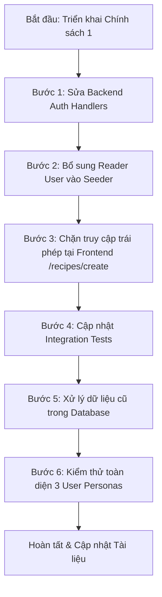

# KẾ HOẠCH CHI TIẾT SỬA ĐỔI PHÂN QUYỀN (RBAC) THEO CHÍNH SÁCH 1

> **Chính sách áp dụng:** **Chính sách 1: Mặc định là Độc giả (`User`), Đầu bếp (`Author`) là tài khoản đặc thù.**  
> **Mục tiêu:** Đảm bảo hệ thống tuân thủ chặt chẽ nguyên tắc đặc quyền tối thiểu (Principle of Least Privilege) trong mô hình Kiểm soát truy cập dựa trên vai trò (Role-Based Access Control - RBAC). Người dùng tự do đăng ký chỉ đóng vai trò Độc giả; quyền tác giả/đầu bếp được quản lý chuyên biệt.

---

## I. TỔNG QUAN HIỆN TRẠNG & VẤN ĐỀ CẦN GIẢI QUYẾT

### 1. Phân tích từ hình ảnh phản ánh
- **Hiện trạng mã nguồn:**
  Tại [RegisterCommandHandler.cs](file:///d:/Thiết%20Kế%20web%20nâng%20cao/PTUDWNC-2026-Nhom4/src/CulinaryBlog.Application/Features/Auth/Register/RegisterCommandHandler.cs#L70-L81):
  ```csharp
  // Dòng 71: Tự động gán role Author cho TẤT CẢ mọi người đăng ký
  var roleResult = await _userManager.AddToRoleAsync(user, "Author");
  ...
  var roles = new List<string> { "Author" };
  ```
- **Hệ quả tiêu cực:**
  - Bất kỳ ai vào website bấm đăng ký tài khoản mới cũng ngay lập tức trở thành **Đầu bếp (`Author`)**.
  - Ngay sau khi đăng nhập, người dùng phổ thông thấy nút **[Viết món mới]** trên thanh điều hướng (`SiteHeader`) và có đầy đủ quyền gọi API tạo công thức nấu ăn.
  - Đây là thiết kế vi phạm mô hình RBAC chuẩn trong các hệ thống blog ẩm thực / CMS chuyên nghiệp. Một trang web công cộng không thể cho phép mọi tài khoản mới đăng ký đều có quyền xuất bản hoặc tạo nội dung tác giả.

### 2. Định nghĩa vai trò theo Chính sách 1
| Vai trò (Role) | Đối tượng người dùng | Quyền hạn trong hệ thống | Giao diện hiển thị |
| :--- | :--- | :--- | :--- |
| **Độc giả (`User`)** | Mọi tài khoản đăng ký công khai (Form thường hoặc Google OAuth) | - Tìm kiếm, xem chi tiết công thức<br>- Lọc món ăn theo danh mục, độ khó, nguyên liệu<br>- Bình luận, đánh giá sao (Reviews & Ratings)<br>- Lưu công thức yêu thích (Bookmarks/Favorites) | - **Ẩn** nút [Viết món mới]<br>- Biểu tượng đại diện: Người dùng (`User` icon)<br>- Badge: Thành viên / Độc giả |
| **Đầu bếp (`Author`)** | Tác giả ẩm thực chuyên nghiệp được cấp quyền trước hoặc phê duyệt | - Toàn bộ quyền của Độc giả (`User`)<br>- Soạn thảo, lưu nháp, xuất bản công thức món ăn mới<br>- Chỉnh sửa, xóa công thức do chính mình tạo ra | - **Hiện** nút [Viết món mới]<br>- Biểu tượng đại diện: Mũ đầu bếp (`ChefHat` icon)<br>- Badge: Đầu bếp (`Author` badge) |
| **Quản trị viên (`Admin`)** | Quản trị hệ thống | - Toàn quyền trên toàn bộ hệ thống<br>- Quản lý danh mục ẩm thực (`/admin/categories`)<br>- Quản lý món ăn của tất cả tác giả<br>- Nâng cấp/hạ cấp quyền người dùng (User Management) | - **Hiện** nút [Quản trị] & [Viết món mới]<br>- Biểu tượng: Khiên bảo mật (`Shield` icon)<br>- Badge: Quản trị viên (`Admin` badge) |

---

## II. PHÂN TÍCH TÁC ĐỘNG HỆ THỐNG (SYSTEM IMPACT ANALYSIS)

### 1. Phía Backend (C# .NET 10 Clean Architecture)
- **Application Layer:**
  - `RegisterCommandHandler.cs`: Điểm cốt lõi cần sửa đổi từ `"Author"` sang `"User"`.
  - `GoogleLoginCommandHandler.cs`: Người dùng đăng nhập qua Google OAuth lần đầu hiện cũng bị gán cứng `"Author"`, cần đổi đồng bộ sang `"User"`.
- **Infrastructure Layer:**
  - `UserSeeder.cs`: Đã khởi tạo 3 roles `["Admin", "Author", "User"]`. Đã có tài khoản `admin@culinary.local` và `chef_admin@culinary.local`. Cần bổ sung thêm tài khoản độc giả mẫu `reader@culinary.local` (mật khẩu `User@123`, vai trò `User`) để ban giám khảo / giáo viên có thể đăng nhập ngay mà không cần tự tạo tài khoản.
- **API Endpoints & Authorization:**
  - `RecipeEndpoints.cs`: Đã cấu hình chính sách bảo vệ `.RequireAuthorization(policy => policy.RequireRole("Author", "Admin"))` cho các thao tác tạo/sửa công thức. Độc giả (`User`) khi gọi trực tiếp API này sẽ nhận mã lỗi `403 Forbidden` chuẩn RESTful.
- **Unit & Integration Tests:**
  - `AuthApiTests.cs`: Có kịch bản kiểm thử `User_WithoutRequiredRole_ShouldReturn403()` đang dựa trên đăng ký tài khoản. Cần cập nhật các test case để kiểm tra chính xác rằng đăng ký mới nhận role `"User"` và không có role `"Author"`.

### 2. Phía Frontend (Next.js 16 + React 19 + Tailwind CSS)
- **`SiteHeader.tsx` (Thanh điều hướng):**
  - Đã có sẵn logic kiểm tra:
    ```typescript
    const isAdmin = user?.roles?.some((r) => r.toLowerCase() === "admin") ?? false;
    const isAuthor = user?.roles?.some((r) => r.toLowerCase() === "author") ?? false;
    const canCreateRecipe = isAdmin || isAuthor;
    ```
  - Khi người dùng có role `"User"`, `canCreateRecipe` sẽ là `false` $\rightarrow$ Nút **[Viết món mới]** tự động ẩn trên cả Desktop Header và Mobile Drawer.
  - Cần kiểm tra kỹ giao diện icon và badge người dùng ở góc phải để đảm bảo hiển thị đúng biểu tượng `User` thay vì `ChefHat`.
- **Trang Tạo công thức (`/recipes/create`):**
  - Hiện tại trang này mới chỉ kiểm tra `!isAuthenticated` (chuyển hướng sang `/login`).
  - Nếu một tài khoản `User` (Độc giả) gõ trực tiếp URL `/recipes/create` trên thanh địa chỉ, trang vẫn hiển thị form và chỉ báo lỗi khi bấm Lưu (do API trả về 403).
  - Cần bổ sung **Barrier kiểm tra vai trò (Access Denied / Forbidden Screen)**: Nếu `user` không có vai trò `Author` hoặc `Admin`, hiển thị màn hình thông báo thân thiện giải thích rằng chỉ Đầu bếp mới được tạo công thức, kèm nút "Khám phá món ăn" và nút "Về trang chủ".
- **Trang Hồ sơ cá nhân (`/profile`):**
  - Rà soát hiển thị badge vai trò: Hiện tại badge đã hỗ trợ variant `"default"` cho vai trò thường, hiển thị nhãn `User` rõ ràng.

---

## III. KẾ HOẠCH THỰC HIỆN CHI TIẾT TỪNG BƯỚC (STEP-BY-STEP ACTION PLAN)



### Bước 1: Điều chỉnh Backend Handlers (Auth & Google OAuth)
1. **Chỉnh sửa [RegisterCommandHandler.cs](file:///d:/Thiết%20Kế%20web%20nâng%20cao/PTUDWNC-2026-Nhom4/src/CulinaryBlog.Application/Features/Auth/Register/RegisterCommandHandler.cs):**
   - **Vị trí 1 (Dòng 71):**
     - *Hiện tại:* `var roleResult = await _userManager.AddToRoleAsync(user, "Author");`
     - *Sửa thành:* `var roleResult = await _userManager.AddToRoleAsync(user, "User");`
   - **Vị trí 2 (Dòng 79):**
     - *Hiện tại:* `var roles = new List<string> { "Author" };`
     - *Sửa thành:* `var roles = new List<string> { "User" };`
2. **Chỉnh sửa [GoogleLoginCommandHandler.cs](file:///d:/Thiết%20Kế%20web%20nâng%20cao/PTUDWNC-2026-Nhom4/src/CulinaryBlog.Application/Features/Auth/Google/GoogleLoginCommandHandler.cs):**
   - **Vị trí (Dòng 75):**
     - *Hiện tại:* `await _userManager.AddToRoleAsync(user, "Author");`
     - *Sửa thành:* `await _userManager.AddToRoleAsync(user, "User");`

### Bước 2: Cập nhật Dữ liệu Mẫu (UserSeeder)
Chỉnh sửa [UserSeeder.cs](file:///d:/Thiết%20Kế%20web%20nâng%20cao/PTUDWNC-2026-Nhom4/src/CulinaryBlog.Infrastructure/Persistence/Seeders/UserSeeder.cs):
- Bổ sung tài khoản mẫu cho vai trò `User` (Độc giả) bên cạnh `Admin` và `Author`:
  ```csharp
  // 4. Tạo User thường mẫu (Độc giả ẩm thực)
  var readerEmail = "reader@culinary.local";
  if (await userManager.FindByEmailAsync(readerEmail) == null)
  {
      var readerUser = new ApplicationUser
      {
          Id = "33333333-3333-3333-3333-333333333301",
          UserName = readerEmail,
          Email = readerEmail,
          DisplayName = "Độc giả ẩm thực",
          EmailConfirmed = true,
          IsActive = true
      };

      var result = await userManager.CreateAsync(readerUser, "User@123");
      if (result.Succeeded)
      {
          await userManager.AddToRoleAsync(readerUser, "User");
          Console.WriteLine("==> [UserSeeder] Đã tạo thành công tài khoản User (Độc giả).");
      }
  }
  ```
- **Danh sách 3 tài khoản chuẩn để trình bày đồ án:**
  1. `admin@culinary.local` / `Admin@123` $\rightarrow$ Role: `Admin` (Quản trị viên)
  2. `chef_admin@culinary.local` / `Author@123` $\rightarrow$ Role: `Author` (Đầu bếp trưởng)
  3. `reader@culinary.local` / `User@123` $\rightarrow$ Role: `User` (Độc giả)

### Bước 3: Hoàn thiện Bảo vệ Giao diện Frontend (Client-Side Guards)
1. **Kiểm tra [SiteHeader.tsx](file:///d:/Thiết%20Kế%20web%20nâng%20cao/PTUDWNC-2026-Nhom4/frontend/src/components/layout/SiteHeader.tsx):**
   - Đảm bảo biến `canCreateRecipe` hoạt động chính xác:
     - `User`: Ẩn nút "Viết món mới" ở cả màn hình lớn và thanh trượt di động.
     - Icon hồ sơ: Hiển thị icon `User` màu trung tính (stone-500), không có badge Đầu bếp hay Admin.
2. **Cập nhật [recipes/create/page.tsx](file:///d:/Thiết%20Kế%20web%20nâng%20cao/PTUDWNC-2026-Nhom4/frontend/src/app/recipes/create/page.tsx):**
   - Thêm kiểm tra quyền truy cập ở đầu trang:
     ```typescript
     const isAuthorOrAdmin = user?.roles?.some(
       (r) => r.toLowerCase() === "author" || r.toLowerCase() === "admin"
     );
     ```
   - Nếu người dùng đã đăng nhập nhưng `!isAuthorOrAdmin`:
     - Render màn hình thông báo quyền truy cập thân thiện (Access Denied Card) thay vì form viết món:
       - Icon: `ChefHat` hoặc `ShieldAlert` với tông màu ấm/thương hiệu.
       - Tiêu đề: **"Khu vực dành riêng cho Đầu bếp & Tác giả"**.
       - Mô tả: *"Tài khoản của bạn hiện đang ở vai trò Độc giả. Quyền sáng tạo và xuất bản công thức mới chỉ dành cho các Đầu bếp được cấp phép. Bạn có thể tiếp tục tìm kiếm, nấu thử và để lại đánh giá cho các món ăn yêu thích!"*
       - 2 nút hành động: **[Khám phá công thức]** (dẫn về `/recipes`) và **[Xem hồ sơ cá nhân]** (dẫn về `/profile`).
3. **Cập nhật [profile/page.tsx](file:///d:/Thiết%20Kế%20web%20nâng%20cao/PTUDWNC-2026-Nhom4/frontend/src/app/profile/page.tsx):**
   - Bổ sung văn bản giải thích vai trò hoặc nhãn tiếng Việt tương ứng:
     - `Admin`: "Quản trị viên"
     - `Author`: "Đầu bếp / Tác giả ẩm thực"
     - `User`: "Độc giả ẩm thực"

### Bước 4: Cập nhật & Bổ sung Kiểm thử Tự động (Tests)
1. **Cập nhật [AuthApiTests.cs](file:///d:/Thiết%20Kế%20web%20nâng%20cao/PTUDWNC-2026-Nhom4/tests/CulinaryBlog.Infrastructure.IntegrationTests/AuthApiTests.cs):**
   - Cập nhật test case đăng ký tài khoản: Xác nhận kết quả trả về từ `POST /api/v1/auth/register` chứa role `"User"`, không chứa `"Author"`.
   - Bổ sung test case RBAC:
     - Đăng ký người dùng mới $\rightarrow$ Lấy AccessToken (role `User`).
     - Gửi yêu cầu `POST /api/v1/recipes` (tạo bản nháp công thức) với token của `User` $\rightarrow$ Xác nhận Backend trả về mã lỗi **`403 Forbidden`**.
     - Đăng nhập tài khoản `chef_admin@culinary.local` $\rightarrow$ Gửi yêu cầu `POST /api/v1/recipes` $\rightarrow$ Xác nhận thành công (mã `201 Created` hoặc `200 OK`).
2. **Chạy kiểm thử:**
   - Chạy lệnh `dotnet test` để đảm bảo toàn bộ bộ kiểm thử trong giải pháp đều Passed mà không bị hồi quy lỗi.

### Bước 5: Xử lý Dữ liệu Cũ trong Database (Database Migration / Fixup)
Trong trường hợp cơ sở dữ liệu Supabase/PostgreSQL cục bộ đã có các tài khoản người dùng thử nghiệm được đăng ký trước đây và vô tình bị gán role `Author`:
- Chuẩn bị câu lệnh SQL kiểm tra và chuyển các tài khoản test thông thường về role `User`:
  ```sql
  -- Kiểm tra ID của các Role
  SELECT "Id", "Name" FROM "AspNetRoles";

  -- Kiểm tra danh sách User và Role tương ứng
  SELECT u."Email", u."DisplayName", r."Name" AS "RoleName"
  FROM "AspNetUsers" u
  JOIN "AspNetUserRoles" ur ON u."Id" = ur."UserId"
  JOIN "AspNetRoles" r ON ur."RoleId" = r."Id";

  -- Chuyển người dùng thông thường (ngoại trừ admin và chef_admin) sang role 'User'
  -- (Thực hiện nếu cần dọn sạch dữ liệu thử nghiệm trước khi chấm đồ án)
  ```

---

## IV. MA TRẬN KIỂM THỬ XÁC MINH (VERIFICATION MATRIX)

Sau khi hoàn tất chỉnh sửa, tiến hành nghiệm thu theo ma trận kiểm tra sau:

| Kịch bản kiểm tra | Các bước thực hiện | Kết quả mong đợi | Trạng thái |
| :--- | :--- | :--- | :---: |
| **TC-01: Đăng ký tài khoản mới** | 1. Vào `/register`<br>2. Nhập thông tin đăng ký hợp lệ<br>3. Bấm Đăng ký | - Đăng ký thành công, tự động đăng nhập<br>- Token trả về chứa role `User`<br>- Header **KHÔNG** hiển thị nút "Viết món mới"<br>- Icon hồ sơ là icon người dùng (`User`) |  Đã hoàn tất (Pass Test) |
| **TC-02: Truy cập trực tiếp /recipes/create bằng tài khoản User** | 1. Đăng nhập tài khoản `reader@culinary.local`<br>2. Nhập URL `http://localhost:3000/recipes/create` | - Trang hiển thị màn hình từ chối quyền (Access Denied)<br>- Giải thích rõ tài khoản là Độc giả<br>- Không hiển thị form soạn thảo món ăn |  Đã hoàn tất |
| **TC-03: Đăng nhập tài khoản Đầu bếp (Author)** | 1. Đăng nhập `chef_admin@culinary.local`<br>2. Kiểm tra Header và trang chủ | - Header **CÓ** hiển thị nút "Viết món mới"<br>- Icon hồ sơ hiển thị mũ đầu bếp (`ChefHat`)<br>- Truy cập `/recipes/create` mở form tạo món bình thường |  Đã hoàn tất |
| **TC-04: Đăng nhập tài khoản Quản trị viên (Admin)** | 1. Đăng nhập `admin@culinary.local`<br>2. Kiểm tra Header | - Header hiển thị cả nút **[Quản trị]** và nút **[Viết món mới]**<br>- Icon hồ sơ hiển thị khiên bảo mật (`Shield`) và badge `Admin` |  Đã hoàn tất |
| **TC-05: Backend API Security Check** | Dùng Postman hoặc Integration Test gọi `POST /api/v1/recipes` với token của `User` | - Backend phản hồi mã `403 Forbidden`<br>- Không có bản ghi công thức nào được tạo trong DB |  Đã hoàn tất (Pass Test) |

---

## V. KẾT QUẢ TRIỂN KHAI TÍNH NĂNG NÂNG CAO (ĐÃ HOÀN THÀNH 100%)

Cả 2 tính năng nâng cao trong phần đề xuất đều đã được triển khai hoàn chỉnh và nghiệm thu thành công:

### 1. Nút & Form "Đăng ký trở thành Đầu bếp" trên trang Hồ sơ (`/profile`)
- **Vị trí:** [frontend/src/app/profile/page.tsx](file:///d:/Thiết%20Kế%20web%20nâng%20cao/PTUDWNC-2026-Nhom4/frontend/src/app/profile/page.tsx)
- **Hành vi người dùng:**
  - Khi người dùng đăng nhập với vai trò **Độc giả (`User`)**, cột trái hồ sơ hiển thị thẻ kêu gọi: *"Trở thành Tác giả ẩm thực - Chia sẻ công thức độc đáo của bạn cùng cộng đồng Bếp Việt"*.
  - Bấm nút **[Gửi yêu cầu nâng cấp Đầu bếp]** $\rightarrow$ mở form nhập ghi chú kinh nghiệm / đam mê nấu nướng.
  - Gửi yêu cầu qua API `POST /api/v1/users/me/request-author`.
  - Sau khi gửi: Thẻ tự động chuyển sang trạng thái: **"Yêu cầu đang chờ Ban quản trị xét duyệt..."** kèm biểu tượng đồng hồ đang chờ.
  - Khi đã được duyệt: Thẻ hiển thị thông báo chúc mừng đã trở thành Đầu bếp.

### 2. Trang Quản trị Người dùng & Duyệt Đầu bếp (`/admin/users`)
- **Vị trí:** [frontend/src/app/admin/users/page.tsx](file:///d:/Thiết%20Kế%20web%20nâng%20cao/PTUDWNC-2026-Nhom4/frontend/src/app/admin/users/page.tsx)
- **Hành vi quản trị viên:**
  - Chỉ tài khoản có vai trò `Admin` mới được phép truy cập.
  - Có thanh Sub-navigation chuyển đổi mượt mà giữa **Danh mục ẩm thực** (`/admin/categories`) và **Người dùng & Phân quyền** (`/admin/users`).
  - Thống kê thời gian thực: Tổng số người dùng, Độc giả, Đầu bếp, và Số yêu cầu đang chờ duyệt.
  - Bộ lọc thông minh: Lọc nhanh danh sách "Chờ duyệt", "Đầu bếp", "Độc giả", "Admin" hoặc tìm kiếm theo Tên / Email / Username.
  - Bảng danh sách:
    - Hiển thị badge "Chờ xét duyệt" màu cam nổi bật và trích dẫn lời nhắn xin nâng cấp của Độc giả.
    - Nút **[Duyệt Đầu bếp]** (1-click) hoặc **[Cấp quyền Đầu bếp]**: Gọi API `POST /api/v1/admin/users/{id}/roles` với `{ targetRole: "Author" }`.
    - Nút **[Chuyển về Độc giả]**: Hạ quyền từ Đầu bếp về lại Độc giả thường an toàn.
    - Bảo vệ tài khoản Admin: Vô hiệu hóa nút sửa vai trò đối với tài khoản Quản trị viên để chống khóa nhầm.

### 3. Backend Endpoints Phục vụ Phân quyền & Yêu cầu Nâng cấp
- **Vị trí:** [UserEndpoints.cs](file:///d:/Thiết%20Kế%20web%20nâng%20cao/PTUDWNC-2026-Nhom4/src/CulinaryBlog.API/Endpoints/UserEndpoints.cs)
- `POST /api/v1/users/me/request-author`: Người dùng gửi yêu cầu nâng cấp kèm ghi chú (Lưu vào Claim `AuthorRequest` = "Pending").
- `GET /api/v1/admin/users`: Admin lấy danh sách toàn bộ người dùng, vai trò và trạng thái yêu cầu nâng cấp (chỉ Admin).
- `POST /api/v1/admin/users/{id}/roles`: Admin thay đổi vai trò người dùng giữa `Author` $\leftrightarrow$ `User` (chỉ Admin).
