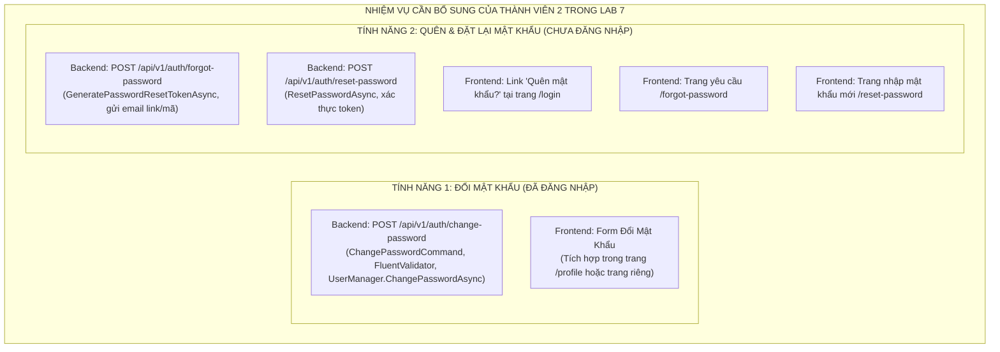

# KẾ HOẠCH TRIỂN KHAI VÀ HOÀN THIỆN TIÊU CHÍ LAB 7 — THÀNH VIÊN 2
## DỰ ÁN: CULINARY BLOG (BẾP VIỆT BLOG) — NHÓM 4
> **Môn học:** Phát triển Ứng dụng Web Nâng cao (PTUDWNC)  
> **Thành viên 2:** Hoàng Trịnh Việt Linh — **MSSV:** 2312664  
> **Module đảm nhiệm:** Module Xác thực & Quản lý Người dùng (FR-AUTH) & Tác vụ Email Nền (FR-JOB) & Phụ trách chung Frontend  
> **Tài liệu tham chiếu:** SRS v1.0.0 (IEEE 830) & Yêu cầu tối thiểu Lab 7 & Quy chuẩn thiết kế `nguyentacfontend.md`  
> **Ngày lập kế hoạch:** 27/10/2026  

---

## 2. BẢNG ĐỐI CHIẾU 6 TIÊU CHÍ TỐI THIỂU CỦA LAB 7 VÀ HIỆN TRẠNG DỰ ÁN

| STT | Tiêu chí tối thiểu của Lab 7 | Người phụ trách chính | Trạng thái hiện tại | Đánh giá chi tiết |
| :---: | :--- | :---: | :---: | :--- |
| **1** | **Hoàn thành các tính năng: Đăng ký, Đăng nhập, Đăng xuất, Đổi mật khẩu, Quên mật khẩu** | **Thành viên 2** *(Hoàng Trịnh Việt Linh)* |  **Đã hoàn thành 100%** | • **Đầy đủ:** Đăng ký (Register), Đăng nhập (Login - Lockout 5 lần), Đăng xuất (Logout / Token Revocation). • **Đã bổ sung:** Chức năng **Đổi mật khẩu** (Change Password) và **Quên / Đặt lại mật khẩu** (Forgot/Reset Password) hoàn chỉnh ở cả Backend (.NET 10 CQRS Minimal API) lẫn Frontend (Next.js App Router). |
| **2** | **Hoàn thành xây dựng trang hồ sơ (Profile), cho phép cập nhật hồ sơ** | **Thành viên 2** *(Hoàng Trịnh Việt Linh)* |  **Đã hoàn thành 100%** | • **Đầy đủ:** Trang `frontend/src/app/profile/page.tsx` nạp thông tin từ `GET /api/v1/auth/me`, cập nhật hồ sơ qua `PATCH /api/v1/auth/profile` (DisplayName, Avatar, Bio), xử lý lỗi RFC 7807 và Skeleton Shimmer. • **Đã tích hợp:** Tab/Section **Đổi mật khẩu** trực tiếp trên trang Profile với đầy đủ validation và xử lý an ninh. |
| **3** | **Hoàn thành xây dựng trang chủ (đủ Header, Footer, Sidebar hiển thị Category, Main content hiển thị công thức mới)** | Cả nhóm *(TV2 dựng Layout, TV1 Category, TV3/TV4 Công thức)* |  **Đã hoàn thành 100%** | • `SiteHeader` và `SiteFooter` chuẩn trong `layout.tsx`. • `RecipeCategorySidebar` hiển thị danh mục bên cột trái. • `RecipeGrid` hiển thị danh sách công thức mới nhất kèm thanh phân trang và ô tìm kiếm Hero. |
| **4** | **Hoàn thành xây dựng trang xem chi tiết công thức (Món ăn)** | Thành viên 3 & 4 *(Phan Khánh Vương & Lê Phạm Mi Đoan)* |  **Đã hoàn thành 100%** | • Đã triển khai tại `frontend/src/app/recipes/[slug]/page.tsx` chuẩn Budget Bytes: Recipe Box, Checklist nguyên liệu, Đồng hồ bấm giờ từng bước (Step Timers), Bảng dinh dưỡng, In/Chia sẻ, Schema SEO JSON-LD. |
| **5** | **Hoàn thành cài đặt chức năng tìm kiếm** | Thành viên 4 *(Lê Phạm Mi Đoan)* |  **Đã hoàn thành 100%** | • Đã triển khai tại `frontend/src/app/recipes/page.tsx`: Tìm kiếm toàn văn bản FTS tiếng Việt `unaccent`, bộ lọc đa tiêu chí (Danh mục, độ khó, thời gian, khẩu phần), sắp xếp và phân trang URL params. |
| **6** | **Hoàn thành xây dựng trang xem danh sách tất cả Category** | Thành viên 1 *(Nguyễn Thị Trà My)* |  **Đã hoàn thành 100%** | • Đã triển khai tại `frontend/src/app/categories/page.tsx` và `frontend/src/app/categories/[slug]/page.tsx` hiển thị lưới danh mục và danh sách món ăn thuộc từng danh mục. |

---

## 3. PHÂN TÍCH CHI TIẾT CÁC PHẦN CÒN THIẾU CỦA THÀNH VIÊN 2

Để hoàn thành **100% Tiêu chí số 1 & hoàn thiện triệt để Tiêu chí số 2**, Thành viên 2 cần bổ sung 2 cụm chức năng an ninh trọng tâm sau:

### 3.1. Chức năng Đổi mật khẩu (Change Password)
* **Mục đích:** Cho phép người dùng đang đăng nhập thay đổi mật khẩu hiện tại sang mật khẩu mới.
* **Quy tắc an ninh:**
  * Bắt buộc người dùng phải xác thực (`[Authorize]`).
  * Nhập đúng `Mật khẩu hiện tại` (Current Password).
  * `Mật khẩu mới` (New Password) tối thiểu 8 ký tự, phải có chữ hoa, chữ thường, số, không trùng mật khẩu cũ.
  * `Xác nhận mật khẩu mới` (Confirm New Password) phải trùng khớp 100%.
  * Sau khi đổi mật khẩu thành công: Tùy chọn thu hồi các Refresh Token cũ trên thiết bị khác để bảo đảm an toàn.

### 3.2. Chức năng Quên mật khẩu & Đặt lại mật khẩu (Forgot & Reset Password)
* **Mục đích:** Hỗ trợ người dùng lấy lại quyền truy cập tài khoản khi bị quên mật khẩu.
* **Quy tắc an ninh:**
  * **Bước 1 (Gửi yêu cầu):** Người dùng nhập Email -> Backend tạo Password Reset Token an toàn thông qua ASP.NET Core Identity `UserManager.GeneratePasswordResetTokenAsync(user)`.
  * **Bước 2 (Gửi email thông báo):** Tích hợp qua `IEmailService.SendPasswordResetEmailAsync` (hoặc log token an toàn trong môi trường Dev/Test), gửi liên kết đặt lại dạng:  
    `/reset-password?email={email}&token={encodedToken}`.
  * **Chống Brute Force / Enumeration:** Nếu email không tồn tại trong hệ thống, API vẫn phản hồi thông báo chung chung ("Nếu email tồn tại trong hệ thống, liên kết đặt lại đã được gửi") để ngăn chặn kẻ tấn công dò quét email người dùng hợp lệ.
  * **Bước 3 (Đặt lại mật khẩu):** Người dùng nhấp vào link trên email (hoặc nhập token), nhập mật khẩu mới và xác nhận mật khẩu -> Backend gọi `UserManager.ResetPasswordAsync(user, token, newPassword)`.

---

## 4. KẾ HOẠCH TRIỂN KHAI CHI TIẾT (ACTION PLAN)

### 🚀 Giai đoạn 1: Xây dựng Backend .NET 10 Minimal APIs & MediatR CQRS
1. **Định nghĩa DTOs trong `CulinaryBlog.Application/DTOs/`:**
   * `ChangePasswordRequest.cs` (CurrentPassword, NewPassword, ConfirmNewPassword)
   * `ForgotPasswordRequest.cs` (Email)
   * `ResetPasswordRequest.cs` (Email, Token, NewPassword, ConfirmNewPassword)
2. **Cài đặt CQRS Handlers & FluentValidation trong `CulinaryBlog.Application/Features/Auth/`:**
   * Tạo thư mục `Features/Auth/ChangePassword/`:
     - `ChangePasswordCommand.cs`
     - `ChangePasswordCommandValidator.cs`
     - `ChangePasswordCommandHandler.cs` (Sử dụng `UserManager.ChangePasswordAsync`)
   * Tạo thư mục `Features/Auth/ForgotPassword/`:
     - `ForgotPasswordCommand.cs`
     - `ForgotPasswordCommandValidator.cs`
     - `ForgotPasswordCommandHandler.cs` (Sử dụng `UserManager.GeneratePasswordResetTokenAsync`, gọi `IEmailService`)
   * Tạo thư mục `Features/Auth/ResetPassword/`:
     - `ResetPasswordCommand.cs`
     - `ResetPasswordCommandValidator.cs`
     - `ResetPasswordCommandHandler.cs` (Sử dụng `UserManager.ResetPasswordAsync`)
3. **Mở rộng `IEmailService` & `MailKitEmailService`:**
   * Thêm hàm `Task SendPasswordResetEmailAsync(string toEmail, string displayName, string resetToken, string resetUrl, CancellationToken cancellationToken = default);`
4. **Đăng ký Minimal API Endpoints trong `CulinaryBlog.API/Endpoints/AuthEndpoints.cs`:**
   * `POST /api/v1/auth/change-password` (.RequireAuthorization(), Produces 200/400/401/422)
   * `POST /api/v1/auth/forgot-password` (.AllowAnonymous(), RequireRateLimiting("auth-sensitive"), Produces 200/422/429)
   * `POST /api/v1/auth/reset-password` (.AllowAnonymous(), RequireRateLimiting("auth-sensitive"), Produces 200/400/422/429)
5. **Viết Unit Tests bổ sung trong `CulinaryBlog.Application.UnitTests`:**
   * `ChangePasswordCommandHandlerTests.cs` (kiểm thử đổi mật khẩu đúng, sai mật khẩu hiện tại, lỗi validation)
   * `ResetPasswordCommandHandlerTests.cs` (kiểm thử đặt lại mật khẩu với token hợp lệ / không hợp lệ)

### 🚀 Giai đoạn 2: Cập nhật Types & API Service trên Frontend Next.js
1. **Cập nhật `frontend/src/types/auth.ts`:**
   * Bổ sung các interface: `ChangePasswordRequest`, `ForgotPasswordRequest`, `ResetPasswordRequest`.
2. **Cập nhật `frontend/src/services/authService.ts`:**
   * Bổ sung hàm `changePassword(request: ChangePasswordRequest): Promise<void>`
   * Bổ sung hàm `forgotPassword(request: ForgotPasswordRequest): Promise<{ message: string; resetToken?: string }>`
   * Bổ sung hàm `resetPassword(request: ResetPasswordRequest): Promise<void>`

### 🚀 Giai đoạn 3: Phát triển Giao diện Người dùng (Frontend Next.js App Router)
1. **Cập nhật trang Đăng nhập (`frontend/src/app/login/page.tsx`):**
   * Bổ sung liên kết *"Quên mật khẩu?"* phía trên nút Đăng nhập dẫn tới route `/forgot-password`.
2. **Xây dựng trang Yêu cầu Quên mật khẩu (`frontend/src/app/forgot-password/page.tsx`):**
   * Giao diện phong cách ấm cúng Cozy Kitchen (Budget Bytes): Card trắng bo góc, logo ChefHat, icon Mail.
   * Form Zod validation kiểm tra định dạng email.
   * Trạng thái gửi thành công: Hiển thị hướng dẫn kiểm tra hòm thư, kèm nút chuyển nhanh tới trang nhập mã hoặc về trang Đăng nhập.
3. **Xây dựng trang Đặt lại mật khẩu (`frontend/src/app/reset-password/page.tsx`):**
   * Đọc tự động `token` và `email` từ URL Query Parameters (`useSearchParams`).
   * Trường nhập Mật khẩu mới và Xác nhận mật khẩu mới có icon mắt ẩn/hiện mật khẩu.
   * Xử lý lỗi token hết hạn/không hợp lệ, báo lỗi RFC 7807 tiếng Việt trực quan.
   * Đặt lại thành công tự động hiển thị thông báo xanh và nút chuyển hướng về `/login`.
4. **Nâng cấp trang Hồ sơ cá nhân (`frontend/src/app/profile/page.tsx`):**
   * Thêm thẻ Card *"Bảo mật & Mật khẩu"* (hoặc Tab chuyển đổi):
     - Ô nhập Mật khẩu hiện tại
     - Ô nhập Mật khẩu mới
     - Ô nhập Xác nhận mật khẩu mới
     - Nút "Cập nhật mật khẩu" có loading state, thông báo thành công và xóa trắng form sau khi lưu.

### 🚀 Giai đoạn 4: Kiểm thử, Tối ưu & Nghiệm thu
1. **Kiểm thử Backend:**
   * Chạy toàn bộ Unit Tests: `dotnet test` (đảm bảo 100% tests Passed).
   * Kiểm thử Build Web API: `dotnet build` đạt 0 Warnings, 0 Errors.
2. **Kiểm thử Frontend:**
   * Kiểm tra TypeScript: `npm run typecheck` đạt 0 lỗi.
   * Kiểm tra Build Production: `npm run build` tạo thành công tất cả static/dynamic routes.
3. **Kiểm thử luồng nghiệp vụ (End-to-End Flow):**
   * Đăng ký -> Đăng nhập -> Vào Profile đổi mật khẩu -> Đăng xuất -> Đăng nhập bằng mật khẩu mới.
   * Đăng xuất -> Nhấn Quên mật khẩu -> Nhập email -> Nhận mã đặt lại -> Đặt lại mật khẩu mới -> Đăng nhập thành công.

---

## 5. BẢNG CHECKLIST NGHIỆM THU (DEFINITION OF DONE - DOD)

- [x] Backend có đủ 3 endpoint: `/api/v1/auth/change-password`, `/api/v1/auth/forgot-password`, `/api/v1/auth/reset-password`
- [x] Xử lý mật khẩu đúng chuẩn ASP.NET Core Identity PBKDF2 hash, rate limit chống brute force
- [x] Frontend có trang `/forgot-password`, `/reset-password` và form đổi mật khẩu trên `/profile`
- [x] Toàn bộ thông báo lỗi và phản hồi người dùng chuyển ngữ 100% Tiếng Việt thân thiện
- [x] `dotnet test` chạy thành công toàn bộ test cases (140/140 passed: 45 unit tests, 95 integration tests)
- [x] `npm run build` frontend biên dịch thành công 0 lỗi (13 static/dynamic routes).
