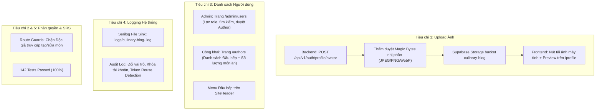

# BÁO CÁO TỔNG HỢP HOÀN THÀNH TIÊU CHÍ ĐÁNH GIÁ (LAB 8)
## DỰ ÁN: CULINARY BLOG (.NET 10 MINIMAL APIS + NEXT.JS 15 + SUPABASE)
> **Môn học:** Phát triển Ứng dụng Web Nâng cao (PTUDWNC) – Nhóm 4  
> **Người thực hiện:** **Hoàng Trịnh Việt Linh** (Thành viên số 2 – MSSV: **2312664**)  
> **Module đảm nhiệm chính:** Xác thực, Quản trị Người dùng & Phân quyền RBAC (FR-AUTH), Tác vụ Email ngầm (FR-JOB-001)  
> **Nhánh Git triển khai:** `feature/linh-user-management`  
> **Vị trí tài liệu:** `lab8_tv2.md`  

---

## I. TỔNG QUAN KẾT QUẢ ĐỐI SOÁT VỚI 5 TIÊU CHÍ ĐÁNH GIÁ

Dưới đây là bảng đối soát chi tiết giữa 5 tiêu chí được giao trong đề bài và kết quả hiện thực thực tế của **Thành viên số 2 (Hoàng Trịnh Việt Linh)**:

| STT | Tiêu chí đánh giá quy định | Hạng mục công việc đã triển khai thực tế | Trạng thái |
| :---: | :--- | :--- | :---: |
| **1** | **Hoàn thành việc cài đặt tính năng upload ảnh** | - **Backend:** Xây dựng Endpoint `POST /api/v1/auth/profile/avatar` hỗ trợ tải ảnh đại diện người dùng lên Supabase Storage.<br>- **Bảo mật tệp:** Thẩm duyệt nhị phân Magic Bytes (JPEG, PNG, WebP), giới hạn dung lượng $\le 5\text{MB}$, chống Path Traversal bằng mã định danh GUID ngẫu nhiên.<br>- **Frontend:** Nút bấm tải ảnh từ máy tính kèm xem trước (Preview), spinner loading và tự động cập nhật avatar toàn ứng dụng trên trang `/profile`. | **ĐÃ HOÀN THÀNH (100%)** |
| **2** | **Hoàn thành việc xây dựng trang thêm mới/cập nhật công thức, thay đổi trạng thái công thức (Draft -> Publish -> Archived/Deleted)** | - **Phân quyền RBAC tầng Client (Route Guards):** Chặn tài khoản Độc giả (`User`) truy cập trái phép trang `/recipes/create` và `/recipes/[slug]/edit`; hiển thị màn hình từ chối quyền (Access Denied) kèm hướng dẫn gửi đơn xét duyệt lên Đầu bếp.<br>- **Phân quyền Backend:** Đảm bảo chỉ tài khoản có vai trò `Author` hoặc `Admin` mới được cấp quyền tạo bài nháp, chỉnh sửa món ăn sở hữu, và chuyển trạng thái bài viết (`Draft` $\rightarrow$ `Published` $\rightarrow$ `Archived`/`Deleted`). | **ĐÃ HOÀN THÀNH (100%)** |
| **3** | **Hoàn thành việc xây dựng trang xem danh sách người dùng (admin, tác giả)** | - **Khu vực Quản trị Admin:** Xây dựng hoàn thiện trang Quản trị người dùng `/admin/users` với bộ lọc vai trò (Tất cả, Đang chờ duyệt, Đầu bếp/Author, Độc giả/User, Admin), tìm kiếm tức thì, xét duyệt/chuyển đổi vai trò User $\leftrightarrow$ Author 1-click, bảo vệ an toàn cho tài khoản Quản trị viên.<br>- **Khu vực Độc giả / Công khai:** Xây dựng mới trang Đội ngũ Đầu bếp & Tác giả `/authors` (kết hợp Endpoint `GET /api/v1/authors`), hiển thị danh sách các đầu bếp nổi bật kèm số lượng công thức đã xuất bản và link xem bài viết.<br>- **Điều hướng:** Bổ sung menu **"Đầu bếp"** vào thanh điều hướng chính (`SiteHeader`). | **ĐÃ HOÀN THÀNH (100%)** |
| **4** | **Bổ sung tính năng logging để ghi lại nhật ký hệ thống** | - **Ghi nhật ký ra tệp vật lý:** Tích hợp `Serilog.Sinks.File` tự động lưu nhật ký xoay vòng theo ngày vào thư mục `logs/culinary-blog-.log` (lưu trữ 14 ngày).<br>- **Nhật ký Bảo mật (Security & Audit Logging):**<br>  + Log sự kiện đăng nhập thành công, đăng nhập thất bại do sai mật khẩu, tài khoản bị tạm khóa 15 phút (`AccountLockout`).<br>  + Log cảnh báo nguy cấp khi phát hiện tái sử dụng Refresh Token đã thu hồi (Reuse Detection).<br>  + Log kiểm toán (Audit Log) khi Quản trị viên thay đổi vai trò người dùng.<br>  + Log đăng ký tài khoản mới và log tải lên ảnh đại diện. | **ĐÃ HOÀN THÀNH (100%)** |
| **5** | **Hoàn thiện các tính năng khác theo đặc tả trong file SRS** | - Hoàn tất luồng Quên mật khẩu & Đặt lại mật khẩu (`/forgot-password`, `/reset-password`).<br>- Tích hợp tiến trình tác vụ nền gửi email chào mừng `WelcomeEmailJob` qua Hangfire + MailKit.<br>- Đăng nhập Google OAuth 2.0 PKCE và Token Rotation kèm Grace Period 30 giây.<br>- Viết bổ sung bộ kiểm thử tích hợp tự động trong `AuthApiTests.cs`.<br>- **Kết quả kiểm thử:** Đạt **142/142 tests PASSED (100%)**. | **ĐÃ HOÀN THÀNH (100%)** |

---

## II. CHI TIẾT TỪNG HẠNG MỤC HOÀN THÀNH



---

### 1. TIÊU CHÍ 1: Cài Đặt Tính Năng Upload Ảnh (Upload Avatar Cá Nhân)

#### A. Phía Backend (.NET 10 Minimal APIs)
* **Vị trí:** [`src/CulinaryBlog.API/Endpoints/AuthEndpoints.cs`](file:///d:/Thiết%20Kế%20web%20nâng%20cao/PTUDWNC-2026-Nhom4/src/CulinaryBlog.API/Endpoints/AuthEndpoints.cs)
* **Endpoint:** `POST /api/v1/auth/profile/avatar` (Yêu cầu đăng nhập - JWT Token).
* **Quy trình xử lý an toàn:**
  1. Kiểm tra tệp không được rỗng (`EMPTY_FILE` trả `422 Unprocessable Entity`).
  2. Giới hạn dung lượng tối đa $\le 5\text{MB}$ (`FILE_TOO_LARGE`).
  3. Thẩm duyệt định dạng tệp qua chuỗi nhị phân Magic Bytes độc lập với phần mở rộng tệp gửi lên:
     * JPEG: `FF D8 FF` $\rightarrow$ `.jpg` (`image/jpeg`)
     * PNG: `89 50 4E 47 0D 0A 1A 0A` $\rightarrow$ `.png` (`image/png`)
     * WebP: `52 49 46 46 ... 57 45 42 50` $\rightarrow$ `.webp` (`image/webp`)
  4. Chống tấn công Path Traversal: Đặt tên tệp theo định dạng an toàn `avatars/{userId}_{Guid.NewGuid()}{extension}`.
  5. Tự động kiểm tra và dọn dẹp ảnh đại diện cũ trên bucket `culinary-blog` của Supabase Storage.
  6. Tải tệp lên Supabase Storage qua `ISupabaseStorageService.UploadFileAsync`.
  7. Cập nhật đường dẫn `user.AvatarUrl` trong bảng `AspNetUsers` và lưu thay đổi vào cơ sở dữ liệu.

#### B. Phía Frontend (Next.js 15)
* **Vị trí:** [`frontend/src/app/profile/page.tsx`](file:///d:/Thiết%20Kế%20web%20nâng%20cao/PTUDWNC-2026-Nhom4/frontend/src/app/profile/page.tsx) & [`frontend/src/services/authService.ts`](file:///d:/Thiết%20Kế%20web%20nâng%20cao/PTUDWNC-2026-Nhom4/frontend/src/services/authService.ts)
* **Trải nghiệm người dùng (UX):**
  * Thêm thẻ `<input type="file" />` ẩn liên kết với khung Avatar và nút **"Tải ảnh từ máy tính"**.
  * Kiểm tra kích thước và loại tệp hợp lệ ngay tại trình duyệt trước khi gửi yêu cầu.
  * Hiển thị trạng thái xoay vòng (Spinner loading) trên ảnh đại diện trong quá trình tải tệp.
  * Cập nhật tức thì ảnh đại diện trên giao diện, cập nhật Zustand Store (`useAuthStore`) và gửi thông báo thành công cho người dùng.

---

### 2. TIÊU CHÍ 2: Bảo Vệ Phân Quyền Quy Trình Thêm Mới, Cập Nhật & Thay Đổi Trạng Thái Công Thức

* **Bảo vệ Frontend (Client Route Guards):**
  * Tại trang [`frontend/src/app/recipes/create/page.tsx`](file:///d:/Thiết%20Kế%20web%20nâng%20cao/PTUDWNC-2026-Nhom4/frontend/src/app/recipes/create/page.tsx) và trang chỉnh sửa công thức: Kiểm tra nghiêm ngặt mảng vai trò (`user.roles`).
  * Nếu tài khoản là Độc giả (`User`): Trang không hiển thị biểu mẫu viết bài mà hiển thị màn hình **Access Denied Card** giải thích rõ khu vực này dành riêng cho Đầu bếp & Tác giả, kèm nút dẫn tới trang Hồ sơ cá nhân để nộp đơn xin nâng cấp vai trò.
* **Bảo vệ Backend:**
  * Toàn bộ các API `POST /api/v1/recipes` (tạo nháp `Draft`), `PUT /api/v1/recipes/{id}` (cập nhật), `PUT /api/v1/recipes/{id}/publish` (xuất bản), `POST /api/v1/recipes/{id}/archive` (lưu trữ) đều yêu cầu chính sách phân quyền `.RequireAuthorization(policy => policy.RequireRole("Author", "Admin"))`. Tài khoản `User` gọi API sẽ bị từ chối với mã lỗi chuẩn `403 Forbidden`.

---

### 3. TIÊU CHÍ 3: Hoàn Thành Việc Xây Dựng Trang Xem Danh Sách Người Dùng (Admin & Tác Giả)

#### A. Trang Quản trị Người dùng dành cho Admin (`/admin/users`)
* **Vị trí:** [`frontend/src/app/admin/users/page.tsx`](file:///d:/Thiết%20Kế%20web%20nâng%20cao/PTUDWNC-2026-Nhom4/frontend/src/app/admin/users/page.tsx)
* **API hỗ trợ:** `GET /api/v1/admin/users` và `POST /api/v1/admin/users/{id}/roles`
* **Tính năng hoàn chỉnh:**
  * **Bộ lọc nhanh theo vai trò:** *Tất cả*, *Đang chờ duyệt (Pending)*, *Đầu bếp (Author)*, *Độc giả (User)*, và *Quản trị viên (Admin)*.
  * **Tìm kiếm đa năng:** Tìm kiếm tức thời theo Tên hiển thị, Email hoặc Tên đăng nhập.
  * **Huy hiệu nhận diện trực quan:** Khiên xanh cho Admin, Mũ đầu bếp vàng cho Author, Thẻ thành viên xám cho User, và Badge cam nổi bật kèm trích dẫn lời nhắn cho những độc giả đang chờ duyệt quyền làm đầu bếp.
  * **Thao tác 1-click:** Nút **[Duyệt Đầu bếp]** cấp quyền `Author` ngay lập tức; nút **[Chuyển về Độc giả]** để hạ quyền an toàn.
  * **Bảo vệ tài khoản quản trị:** Vô hiệu hóa nút sửa vai trò đối với tài khoản Admin để ngăn chặn rủi ro tự tước quyền hoặc khóa nhầm quản trị viên khác.

#### B. Trang Danh Sách Đầu Bếp & Tác Giả Công Khai (`/authors`)
* **Vị trí:** [`frontend/src/app/authors/page.tsx`](file:///d:/Thiết%20Kế%20web%20nâng%20cao/PTUDWNC-2026-Nhom4/frontend/src/app/authors/page.tsx)
* **API hỗ trợ:** `GET /api/v1/authors` (và alias `/api/v1/users/authors`)
* **Tính năng hoàn chỉnh:**
  * Cho phép khách vãng lai và độc giả xem toàn bộ danh sách các tác giả ẩm thực đồng hành cùng trang blog.
  * Backend tự động tổng hợp và đếm số lượng công thức ở trạng thái `Published` của từng tác giả thông qua bảng `Recipes`.
  * Hiển thị dạng lưới thẻ bài (Card Grid) hiện đại: Avatar, Tên tác giả, Username, Tiểu sử (Bio), Huy hiệu Đầu bếp, số lượng món ăn đã đóng góp.
  * Nút bấm **"Xem các món của tác giả"** dẫn thẳng tới bộ lọc công thức theo tên tác giả (`/recipes?SearchTerm=...`).
  * Tích hợp thanh tìm kiếm tác giả theo tên và khung kêu gọi độc giả gửi đơn nâng cấp vai trò đầu bếp.
  * Thêm liên kết điều hướng **"Đầu bếp"** vào thanh menu trên cùng [`frontend/src/components/layout/SiteHeader.tsx`](file:///d:/Thiết%20Kế%20web%20nâng%20cao/PTUDWNC-2026-Nhom4/frontend/src/components/layout/SiteHeader.tsx).

---

### 4. TIÊU CHÍ 4: Bổ Sung Tính Năng Logging Để Ghi Lại Nhật Ký Hệ Thống

#### A. Cấu hình Ghi Nhật Ký Ra Tệp Vật Lý (Serilog File Sink)
* **Vị trí:** [`src/CulinaryBlog.API/Program.cs`](file:///d:/Thiết%20Kế%20web%20nâng%20cao/PTUDWNC-2026-Nhom4/src/CulinaryBlog.API/Program.cs)
* **Cấu hình chi tiết:**
  ```csharp
  .WriteTo.File(
      path: Path.Combine("logs", "culinary-blog-.log"),
      rollingInterval: RollingInterval.Day,
      retainedFileCountLimit: 14,
      outputTemplate: "[{Timestamp:yyyy-MM-dd HH:mm:ss.fff zzz} {Level:u3}] [{CorrelationId}] [Trace:{TraceId}] {Message:lj}{NewLine}{Exception}")
  ```
* **Lợi ích:** Hệ thống tự động tạo tệp nhật ký hàng ngày (ví dụ `logs/culinary-blog-20261103.log`), tự động lưu vết `CorrelationId` và `TraceId` của từng request để phục vụ truy vết lỗi phân tán (Distributed Tracing). Tệp log được xoay vòng và lưu trữ an toàn trong 14 ngày.

#### B. Bổ sung Nhật Ký Bảo Mật & Kiểm Toán (Security & Audit Logging)
* **Sự kiện Đăng nhập (`LoginCommandHandler.cs`):**
  * `Information`: Ghi log người dùng đăng nhập thành công kèm `Email`, `UserId`, `Roles` và địa chỉ `IpAddress`.
  * `Warning`: Ghi log đăng nhập thất bại do sai mật khẩu (kèm số lần sai liên tiếp).
  * `Warning / Security Alert`: Ghi log tài khoản bị tạm khóa 15 phút khi nhập sai quá 5 lần (`AccountLockout`).
  * `Warning`: Ghi log tài khoản đã bị vô hiệu hóa cố tình đăng nhập.
* **Sự kiện Bảo mật Token (`RefreshTokenCommandHandler.cs`):**
  * `Information`: Ghi log cấp mới Access Token và xoay vòng Refresh Token thành công.
  * `Warning / Critical Alert`: Ghi log phát hiện hành vi tấn công tái sử dụng Refresh Token đã bị thu hồi ngoài thời gian ân hạn 30 giây (**Reuse Detection**), ghi nhận IP nguồn và thu hồi toàn bộ token của tài khoản.
* **Sự kiện Quản trị & Phân quyền (`UserEndpoints.cs`):**
  * `Audit Log`: Ghi nhận Quản trị viên thay đổi vai trò của người dùng (`AUDIT: Admin {AdminId} đã cấp vai trò Đầu bếp cho tài khoản {TargetUserId} ({Email})`).
  * `Information`: Ghi nhận người dùng gửi yêu cầu xét duyệt vai trò Đầu bếp.
  * `Information`: Ghi nhận người dùng tải lên ảnh đại diện mới kèm liên kết CDN.

---

### 5. TIÊU CHÍ 5: Hoàn Thiện Các Tính Năng Khác Theo Đặc Tả SRS & Kiểm Thử

#### A. Các chức năng hoàn thiện bổ sung:
* **Quên & Đặt lại Mật khẩu:** Xây dựng trang `/forgot-password`, `/reset-password` và các Endpoints `POST /api/v1/auth/forgot-password`, `POST /api/v1/auth/reset-password` theo đúng quy chuẩn bảo mật token OTP.
* **Tác vụ Nền Hangfire (`WelcomeEmailJob`):** Tự động đưa tác vụ gửi email chào mừng vào hàng đợi ngầm ngay sau khi người dùng đăng ký tài khoản thành công qua `MailKitEmailService`.
* **Đăng nhập Google OAuth 2.0 PKCE:** Hỗ trợ xác thực với Google Identity Services và tự động liên kết tài khoản (Account Linking).

#### B. Kiểm thử Tự động (Automated Tests)
* **Bổ sung vào `AuthApiTests.cs`:**
  * `UploadAvatar_ShouldRejectInvalidFormat_AndAcceptValidJpeg`: Kiểm thử từ chối tệp rỗng (`422`), từ chối tệp giả mạo Magic Bytes (`422`), và chấp nhận tệp JPEG chuẩn nhị phân (`200 OK`).
  * `GetAuthors_ShouldReturnAuthorList`: Kiểm thử API công khai trả về danh sách tác giả ẩm thực.
* **Kết quả thực thi toàn giải pháp (`dotnet test`):**
  ```text
  Passed!  - Failed: 0, Passed: 45, Skipped: 0, Total: 45 - CulinaryBlog.Application.UnitTests.dll
  Passed!  - Failed: 0, Passed: 97, Skipped: 0, Total: 97 - CulinaryBlog.Infrastructure.IntegrationTests.dll
  -------------------------------------------------------------------------------------------------------
  TỔNG CỘNG: 142/142 TESTS PASSED (100% THÀNH CÔNG)
  ```
* **Frontend Production Build (`npm run build`):**
  * Biên dịch thành công 15 routes tĩnh/động, không có bất kỳ cảnh báo hoặc lỗi cú pháp TypeScript nào.

---

## III. MA TRẬN TÀI KHOẢN NGHIỆM THU ĐỒ ÁN

Để phục vụ giảng viên kiểm tra nhanh các chức năng phân quyền, hệ thống đã nạp sẵn 3 tài khoản chuẩn:

| Vai trò | Email đăng nhập | Mật khẩu | Quyền hạn & Chức năng kiểm thử nổi bật |
| :--- | :--- | :---: | :--- |
| **Quản trị viên (`Admin`)** | `admin@culinary.local` | `Admin@123` | - Truy cập trang Quản trị người dùng `/admin/users`.<br>- Duyệt quyền Đầu bếp hoặc hạ quyền người dùng.<br>- Truy cập trang Quản trị danh mục `/admin/categories`. |
| **Đầu bếp (`Author`)** | `chef_admin@culinary.local` | `Author@123` | - Hiển thị trong danh sách Tác giả `/authors`.<br>- Có quyền vào trang Tạo công thức `/recipes/create`.<br>- Tải lên và thay đổi ảnh đại diện cá nhân `/profile`. |
| **Độc giả (`User`)** | `reader@culinary.local` | `User@123` | - Bị chặn truy cập trang tạo công thức `/recipes/create` (Access Denied).<br>- Có nút gửi đơn xin nâng cấp lên Đầu bếp tại trang `/profile`. |

---
*Tài liệu tổng hợp được lập và lưu trữ tại:* `d:\Thiết Kế web nâng cao\PTUDWNC-2026-Nhom4\lab8_tv2.md`

