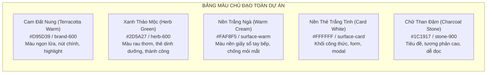
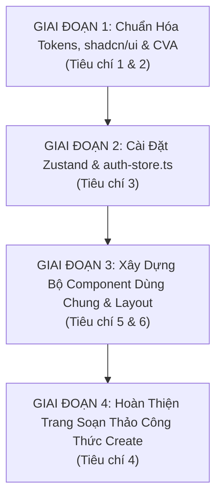

# QUY CHUẨN NGUYÊN TẮC THIẾT KẾ FRONTEND & HỆ THỐNG MÀU SẮC NHẤT THỐNG
## DỰ ÁN: CULINARY BLOG (BẾP VIỆT BLOG) — THEO MẪU THIẾT KẾ BUDGET BYTES
> **Mã tài liệu:** `DESIGN-SYS-CULINARY-V1.0`  
> **Người biên soạn:** Hoàng Trịnh Việt Linh (Thành viên 2 — Phụ trách toàn bộ Frontend)  
> **Áp dụng cho:** Toàn bộ các trang và thành phần giao diện của đồ án (.NET 10 Minimal APIs + Next.js 15 App Router + Tailwind CSS 3.4)  
> **Tài liệu tham chiếu chuẩn:** [Budget Bytes (budgetbytes.com)](https://www.budgetbytes.com) & SRS v1.0.0 & Yêu cầu tối thiểu Lab 6  
> **Vị trí lưu trữ:** `d:\Thiết Kế web nâng cao\PTUDWNC-2026-Nhom4\nguyentacfontend.md`

---

## 1. TẦM NHÌN THIẾT KẾ (DESIGN VISION & CORE PHILOSOPHY)

Trang web **Culinary Blog** được xây dựng dựa trên triết lý trải nghiệm người dùng thực tế của **Budget Bytes** — trang blog ẩm thực danh tiếng thế giới:
* **Gần gũi & Ấm cúng (Cozy & Approachable):** Mang không khí của một gian bếp ấm áp gia đình Việt Nam kết hợp phong cách bố cục hiện đại của tạp chí ẩm thực phương Tây.
* **Tiện dụng trong môi trường nấu nướng (Kitchen-Ready Usability):** Người dùng thường vừa nhìn màn hình điện thoại/máy tính bảng vừa nấu ăn. Do đó, phông chữ phải to, tương phản cao, khoảng cách dòng thoáng và các nút tương tác (checkbox nguyên liệu, bộ đếm giờ, chuyển bước) phải đủ lớn để dễ thao tác ngay cả khi tay ướt hoặc đang bận rộn.
* **Nhất thống thị giác 100% (Strict Visual Consistency):** Mọi trang từ Trang chủ, Danh mục, Chi tiết công thức, Đăng nhập, Hồ sơ cho đến Trang tạo công thức đều phải chia sẻ chung một hệ màu, quy chuẩn bo góc, kiểu chữ và cách thức phản hồi trạng thái.

---

## 2. HỆ THỐNG MÀU SẮC NHẤT THỐNG (UNIFIED COLOR SYSTEM)

Toàn bộ ứng dụng sử dụng bảng màu **Cozy Kitchen Palette** được ánh xạ chính xác vào Tailwind CSS tokens:

### 2.1. Bảng Tra cứu Mã Màu & Ánh xạ Semantic (Tailwind Tokens)

| Vai trò thị giác | Mã màu Hex | Tên biến Tailwind | Ứng dụng cụ thể trên giao diện |
| :--- | :---: | :--- | :--- |
| **Nền trang chính (Page Background)** | `#FAF8F5` | `bg-surface-warm` (hoặc `bg-background`) | Nền tổng thể toàn bộ trang web (thay thế hoàn toàn màu trắng tinh `#FFF` chói mắt). |
| **Nền thẻ nội dung (Card / Box)** | `#FFFFFF` | `bg-white` (hoặc `bg-surface-card`) | Khối Recipe Card, Recipe Box, Form đăng nhập, Bảng danh mục, Khung tìm kiếm. |
| **Viền ngăn cách (Border / Divider)** | `#E7E0D6` | `border-surface-border` | Đường viền các thẻ card, đường gạch ngăn cách giữa các bước nấu và nguyên liệu. |
| **Màu Nhấn Chính (Primary Brand)** | `#D95D39` / `#EA580C` | `bg-brand-600` / `text-brand-600` | Nút kêu gọi hành động chính (CTA), icon nổi bật, số bước nấu, thanh tiến trình, hover link. |
| **Màu Nhấn Hover (Primary Hover)** | `#C2410C` | `bg-brand-700` | Trạng thái rê chuột vào nút chính, tab đang chọn. |
| **Màu Nền Điểm Nhấn Nhẹ (Brand Light)** | `#FFF7ED` | `bg-brand-50` / `text-brand-800` | Nền của các huy hiệu (Badge) loại món, nền thông báo tóm tắt, tag độ khó. |
| **Màu Phụ Trợ Thực Phẩm (Herb Green)** | `#16A34A` / `#2D5A27` | `bg-herb-600` / `text-herb-600` | Tag "Món Chay", "Dưới 30 phút", "Healthy", icon hoàn thành bước nấu, thông báo thành công. |
| **Màu Thảo Mộc Nhẹ (Herb Light)** | `#F0FDF4` | `bg-herb-50` / `text-herb-800` | Nền của huy hiệu dinh dưỡng, ô tích chọn nguyên liệu đã xong. |
| **Chữ Tiêu Đề Chính (Heading Text)** | `#1C1917` | `text-stone-900` | Tiêu đề H1, H2, H3, Tên món ăn, Tên trường form (độ đậm `font-bold` hoặc `font-semibold`). |
| **Chữ Nội Dung Thân (Body Text)** | `#44403C` | `text-stone-700` | Hướng dẫn bước nấu, mô tả món ăn, bài viết (khoảng cách dòng `leading-relaxed`). |
| **Chữ Chú Thích & Thời Gian (Muted)** | `#78716C` | `text-stone-500` | Thời gian chuẩn bị, số lượt xem, tên tác giả, placeholder input, nhãn đơn vị tính. |
| **Màu Cảnh Báo Lỗi (Destructive/Error)** | `#DC2626` | `bg-red-600` / `text-red-600` | Khung thông báo ProblemDetails, nút Xóa công thức, báo lỗi nhập sai form. |

### 2.2. Quy tắc áp dụng màu sắc bắt buộc (Strict Color Rules):
1. **Quy tắc 60-30-10:**
   * **60% Không gian:** Màu nền Trắng ngà (`#FAF8F5`) và Khối thẻ trắng (`#FFFFFF`).
   * **30% Cấu trúc:** Chữ than đá (`#1C1917`), đường viền ấm (`#E7E0D6`) và ảnh món ăn chân thực.
   * **10% Điểm nhấn (Accent):** Màu cam đất nung (`#D95D39`) cho các nút bấm, icon và thông tin cần chú ý.
2. **Tuyệt đối KHÔNG sử dụng:**
   * Không dùng màu xanh dương tím mặc định của trình duyệt (`#0000EE`).
   * Không dùng màu đỏ tươi chói gắt (`#FF0000`) cho nút bấm; chỉ dùng đỏ gạch đất ấm.
   * Không dùng nền đen tuyền `#000000` kể cả ở Dark Mode; Dark mode dùng nền than sâu `#121214`.

---

## 3. CÁC NGUYÊN TẮC THIẾT KẾ ĐẶC QUYỀN HỌC TỪ BUDGET BYTES

### 📌 Nguyên tắc 1: Hộp Công Thức Độc Lập (Signature Recipe Box)
Trên trang chi tiết món ăn ([recipes/[slug]](file:///d:/Thi%E1%BA%BFt%20K%E1%BA%BF%20web%20n%C3%A2ng%20cao/PTUDWNC-2026-Nhom4/frontend/src/app/recipes/%5Bslug%5D/page.tsx)), toàn bộ thông tin nấu ăn cốt lõi phải được đóng gói trong một **Recipe Box** trang trọng:
* **Khung viền:** Bo góc `rounded-2xl`, viền đôi hoặc viền `border-2 border-brand-100`, nền `bg-white` bóng mờ `shadow-md`.
* **Thanh tổng kết Meta:** 4 ô chỉ số xếp ngang (Chuẩn bị, Nấu, Khẩu phần, Độ khó) có icon đại diện và số liệu in đậm to rõ.
* **Nút bấm tiện ích:** Nút "In công thức" (Print Recipe) và "Chia sẻ" (Share) đặt nổi bật ở đầu Recipe Box.

### 📌 Nguyên tắc 2: Tương Tác Danh Sách Nguyên Liệu (Interactive Ingredient Checklist)
* Mỗi dòng nguyên liệu có một **Checkbox tròn hoặc vuông bo góc** (`w-5 h-5`).
* Khi người dùng tích chọn:
  * Checkbox đổi sang màu cam đất `bg-brand-600` kèm dấu tick trắng.
  * Tên nguyên liệu tự động gạch ngang nhẹ (`line-through`) và mờ đi 40% (`opacity-60`) để người nấu biết mình đã cho nguyên liệu đó vào nồi.
* Có nút nhanh *"Bỏ chọn tất cả"* để reset lại khi cần nấu lại.

### 📌 Nguyên tắc 3: Bộ Đếm Giờ Từng Bước Tích Hợp (Step Cooking Timers)
* Đối với các bước nấu có thời gian (ví dụ: *"Đun sôi lăn tăn trong 15 phút"*):
  * Tự động hiển thị một thanh widget bấm giờ nhỏ gọn ngay bên dưới bước đó.
  * Gồm: Đồng hồ đếm ngược `MM:SS`, nút **Bắt đầu (Play)**, **Tạm dừng (Pause)** và **Đặt lại (Reset)**.
  * Khi hết giờ: Tự động rung nhẹ, phát tiếng chuông bíp Web Audio API và đổi màu sang xanh thảo mộc báo hiệu hoàn thành.

### 📌 Nguyên tắc 4: Bảng Giá Trị Dinh Dưỡng Thực Tế (Nutrition Facts Panel)
* Hiển thị dạng thẻ lưới compact: Calo (kcal), Protein (g), Carbohydrate (g), Chất béo (g), Chất xơ (g), Natri (mg).
* Có thanh hiển thị tỷ lệ phần trăm trực quan giúp người xem nhận biết món ăn nhiều đạm hay ít béo.

### 📌 Nguyên tắc 5: Thẻ Món Ăn Bắt Mắt (Appetizing Recipe Cards)
* **Tỉ lệ ảnh:** 4:3 hoặc 16:9, ảnh sắc nét, có lớp phủ gradient mờ nhẹ ở đáy ảnh.
* **Huy hiệu danh mục:** Đặt nổi ở góc trên bên trái ảnh (`top-3 left-3`).
* **Thời gian & Khẩu phần:** Hiển thị dạng chip nhỏ có icon đồng hồ 🕒 và người ăn 👥 ngay dưới tiêu đề.
* **Hiệu ứng Micro-interaction:** Hover ảnh phóng to nhẹ 4% (`scale-105 transition-transform duration-300`), bóng đổ nâng cao nhẹ (`hover:shadow-lg`).

---

## 4. QUY CHUẨN THIẾT KẾ COMPONENT SHADCN/UI (DESIGN SYSTEM TOKENS)

### 4.1. Nút bấm (Button Variants)
* **Default (Primary CTA):** `bg-brand-600 text-white hover:bg-brand-700 shadow-sm font-medium rounded-xl h-11 px-6 active:scale-95 transition-all`
* **Secondary:** `bg-stone-100 text-stone-800 hover:bg-stone-200 rounded-xl h-11 px-6 font-medium`
* **Outline:** `border border-surface-border text-stone-700 bg-white hover:bg-stone-50 rounded-xl h-11 px-6`
* **Destructive:** `bg-red-600 text-white hover:bg-red-700 shadow-sm rounded-xl h-11 px-6`
* **Ghost:** `hover:bg-stone-100 text-stone-700 rounded-xl h-10 px-4`

### 4.2. Thẻ Khối (Card Components)
* Khung bọc `Card`: `bg-white rounded-2xl border border-surface-border shadow-sm overflow-hidden`
* Đầu mục `CardHeader`: `p-6 pb-4 border-b border-stone-100`
* Nội dung `CardContent`: `p-6`
* Chân mục `CardFooter`: `p-6 pt-4 bg-stone-50/50 border-t border-stone-100 flex items-center justify-between`

### 4.3. Ô Nhập Liệu (Input & Textarea)
* Khung nhập: `bg-white border border-stone-300 rounded-xl h-11 px-4 text-stone-900 placeholder:text-stone-400 focus:outline-none focus:ring-2 focus:ring-brand-500 focus:border-brand-500 transition-all`
* Khi có lỗi: `border-red-500 focus:ring-red-500` kèm dòng text lỗi màu đỏ nhỏ phía dưới.

### 4.4. Phân trang Dùng chung (Pagination Component)
* Nút Previous / Next: `h-10 px-4 rounded-xl border border-stone-200 bg-white text-stone-700 hover:bg-stone-50 disabled:opacity-40`
* Ô số trang thường: `w-10 h-10 rounded-xl text-stone-700 hover:bg-stone-100 font-medium`
* Ô số trang đang kích hoạt (Active): `w-10 h-10 rounded-xl bg-brand-600 text-white font-bold shadow-sm`

---

## 5. HỆ THỐNG TRẠNG THÁI NGƯỜI DÙNG (USER EXPERIENCE STATES)

1. **Trạng thái Đang tải (Loading Skeleton Shimmer):**
   * Sử dụng khung xám nhạt `bg-stone-200/70 animate-pulse rounded-xl`.
   * Kích thước Skeleton khớp 1:1 với kích thước thật của Card và Form để loại bỏ hoàn toàn hiện tượng giật giật layout (Cumulative Layout Shift - CLS = 0).
2. **Trạng thái Trống (Empty State):**
   * Hiển thị hình minh họa đĩa ăn/chảo nấu ăn mộc mạc, dòng tiêu đề ấm áp: *"Chưa tìm thấy công thức bạn cần tìm!"*.
   * Gợi ý từ khóa phổ biến: *"Bạn hãy thử tìm kiếm 'Phở bò', 'Bún chả', 'Cá kho tộ' nhé!"* kèm nút Reset bộ lọc.
3. **Trạng thái Thông báo Lỗi (Error State):**
   * Đọc mã lỗi chuẩn RFC 7807 `ProblemDetails` từ backend .NET 10.
   * Chuyển ngữ 100% sang tiếng Việt dễ hiểu (ví dụ: HTTP 423 $\rightarrow$ *"Tài khoản đã bị tạm khóa 15 phút do nhập sai mật khẩu nhiều lần"*).
4. **Trạng thái Thông báo Nổi (Toast Notification):**
   * Vị trí: Góc trên bên phải màn hình (`top-5 right-5 z-50`).
   * Tự đóng sau 3.5 giây, có thanh progress bar chạy đếm ngược, viền bo tròn mềm mại.

---

## 6. KẾ HOẠCH TRIỂN KHAI THEO 4 GIAI ĐOẠN ĐÁP ỨNG TRỌN VẸN LAB 6

### 📋 Chi tiết từng bước thực hiện:

#### 🚀 Giai đoạn 1: Chuẩn hóa Design System & Gói shadcn/ui
1. Cài đặt thư viện: `class-variance-authority` (cva).
2. Khởi tạo cấu hình chuẩn `frontend/components.json` cho Next.js 15 App Router.
3. Tạo file `frontend/src/lib/utils.ts` xuất hàm `cn()`.
4. Cập nhật `frontend/src/services/apiClient.ts` bổ sung Response Interceptor bắt mã lỗi 401 & Silent Refresh.
5. Nâng cấp bộ components trong `src/components/ui/` (`Button`, `Card`, `Badge`, `Input`, `Alert`) áp dụng bảng màu và quy chuẩn bo góc của Budget Bytes.

#### 🚀 Giai đoạn 2: Quản lý Trạng thái Toàn cục với `auth-store.ts`
1. Cài đặt thư viện: `zustand`.
2. Tạo file `frontend/src/stores/auth-store.ts` quản lý:
   * State: `user`, `accessToken`, `isAuthenticated`, `isLoading`.
   * Actions: `login`, `logout`, `setUser`, `initAuth`.
3. Đồng bộ reactive store vào `SiteHeader.tsx`, `login/page.tsx`, `register/page.tsx` và `profile/page.tsx`.

#### 🚀 Giai đoạn 3: Xây dựng Bộ Component Dùng Chung & Tối Ưu Bố Cục
1. Tách component `Pagination.tsx` tái sử dụng tại `frontend/src/components/ui/Pagination.tsx` và tích hợp vào trang `/recipes`.
2. Tạo `frontend/src/components/ui/LoadingSpinner.tsx` & file `frontend/src/app/loading.tsx`.
3. Tạo `frontend/src/components/ui/ErrorState.tsx` & file `frontend/src/app/error.tsx`, `frontend/src/app/not-found.tsx`.
4. Cập nhật [layout.tsx](file:///d:/Thi%E1%BA%BFt%20K%E1%BA%BF%20web%20n%C3%A2ng%20cao/PTUDWNC-2026-Nhom4/frontend/src/app/layout.tsx) tích hợp khởi tạo auth tự động.

#### 🚀 Giai đoạn 4: Hoàn thiện Giao diện Tĩnh Soạn Thảo Món Ăn (`/recipes/create`)
1. Xây dựng trang tĩnh `frontend/src/app/recipes/create/page.tsx` gồm 2 cột:
   * Cột trái: Form thông tin chung, bảng thêm/xóa nguyên liệu động, danh sách bước nấu động có hẹn giờ, khung tải ảnh kéo thả.
   * Cột phải: Live Preview thẻ món ăn theo chuẩn giao diện Budget Bytes.
2. Thêm nút "Viết công thức mới" trên Header (dành cho tác giả đã đăng nhập).

---

## 7. BẢNG CHECKLIST NGHIỆM THU (DEFINITION OF DONE - DOD)

Trước khi nghiệm thu Lab 6, dự án phải vượt qua 100% các tiêu chí sau:

- [ ] **Màu sắc & Thẩm mỹ:** 100% các trang có màu nền trắng ngà `#FAF8F5`, nút cam đất `#D95D39`, chữ than đá `#1C1917` đồng bộ, không bị lệch màu.
- [ ] **Tiêu chí 1 (Tiện ích):** File `apiClient.ts` và `apiError.ts` xử lý chuẩn lỗi RFC 7807 tiếng Việt.
- [ ] **Tiêu chí 2 (shadcn/ui):** Đã có `components.json`, `cva`, `lib/utils.ts`, các component `Button`, `Card` hoạt động mượt mà.
- [ ] **Tiêu chí 3 (State Store):** File `src/stores/auth-store.ts` sử dụng Zustand hoạt động trơn tru, Header tự động cập nhật ngay khi đăng nhập/đăng xuất không cần F5.
- [ ] **Tiêu chí 4 (Giao diện tĩnh):** Đầy đủ các trang: Trang chủ, Danh mục, Chi tiết có Recipe Box, Đăng nhập, Đăng ký, Profile, và Trang tạo bài viết `/recipes/create`.
- [ ] **Tiêu chí 5 (Component dùng chung):** Header, Footer, `Pagination.tsx`, `LoadingSpinner.tsx`, `ErrorState.tsx`, `loading.tsx`, `not-found.tsx` tách biệt độc lập.
- [ ] **Tiêu chí 6 (Bố cục layout):** File `layout.tsx` chuẩn mực, không lỗi giật khung hình.
- [ ] **Kiểm thử chất lượng mã:**
  - `npx tsc --noEmit`: 0 lỗi TypeScript.
  - `npm run lint`: 0 warnings, 0 errors.
  - `npm run build`: Biên dịch Production thành công 100% tất cả các route.

---
*Tài liệu được khởi tạo và lưu trữ chính thức tại:* `d:\Thiết Kế web nâng cao\PTUDWNC-2026-Nhom4\nguyentacfontend.md`
